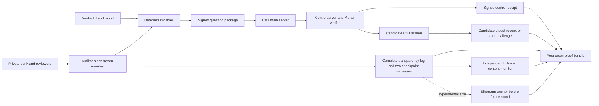

# Muhar digital architecture

Status: proposed architecture, updated 9 November 2026. The reference pilot is **one centre, one session, synthetic questions, and an existing computer-based testing (CBT) interface**. Its declared operational evidence profile is a small, complete, independently witnessed log with a separate full-scan content monitor; one Ethereum anchor over the same pre-seed record is a research-only shadow comparison. Live questions and high-stakes use need institutional approval and an independent security review.

**Iteration 3 changes the first technical build:** [PROPOSAL.md](PROPOSAL.md) makes capacity, centre collusion, multiple exam profiles, and paper confidentiality explicit gates. [SEALED_PAPER_ARCHITECTURE.md](SEALED_PAPER_ARCHITECTURE.md) now specifies a complete synthetic sealed pipeline before an invited mock: scoped item review, encrypted storage, attested assembly, independently governed release, and adversarial tests. The log below supplies evidence; it is not the confidentiality boundary.

## Product boundary

Muhar is an **integrity control plane** beside a CBT delivery system. Muhar fixes the rules, verifies the draw, authorizes and records paper release, and produces evidence. The CBT system handles registration, identity, candidate display, responses, scoring, and accommodations. This boundary matches the main-server → authorised centre-server → candidate-computer path described in India's 2024 Public Examinations Rules; [DoPT's accessible summary](https://persmin.gov.in/DOPT_achievements_2014-2025/InnerFiles/Current_Year_PDF/2025.pdf) confirms the Rules' incident and monitoring framework. An [NTA draft CBT tender](https://nta.ac.in/Download/Tender/Tender_20260302181817.pdf) illustrates operational needs such as full-node mocks, backup power, secure local networks, and independent connectivity. Its terms apply to that procurement, not automatically to every Muhar pilot.
The interface between the two systems is a small, versioned adapter: it accepts a signed paper package, returns a signed receipt for the package digest, and exposes the full digest, form ID, and chosen language/accessible variant to the candidate interface. The CBT import and start paths must **reject** an unsigned package, a digest mismatch, or an unexpected form. They record the verified digest and variant in the private CBT session record. The first mock disables any CBT-side question or option reshuffling; a later per-candidate shuffle would require its own signed ordered-form mapping and digest. The adapter does not need candidate identity to perform the public verification.

If this adapter requires a plaintext import into a central vendor server, that server is a declared plaintext recipient and confidentiality against it ends at import. The sealed profile instead aims for encrypted transport directly to an approved centre runtime, with session/recipient/time-bound signed permits. Two-of-three release approvals are an application quorum, distinct from the two-of-two checkpoint-witness policy and from cryptographic threshold decryption. Root and key-policy override paths remain explicit trust assumptions. Separate papers, supervision, identity, and response-custody claims; a centre can receive the correct package while helping a candidate cheat.

## One session, from preparation to proof

| Phase | Action and evidence | Security decision |
| --- | --- | --- |
| 1. Author and review | Authors and reviewers work on assigned item subsets. Review wording, variants, assets, accessibility, tags, duplicates, and rendering; encrypt each approved version and separate answer keys. The audit function attests the exact inventory and its review coverage with a declared scope. | No routine full-bank master export or omniscient auditor. Historical copies and cumulative reviewer access must be assessed. A person can still leak an item they saw. |
| 2. Announce session | The institution publishes one official opaque session ID and its authorized root-key fingerprint through an independently authenticated schedule/charter. The charter fixes admission, late-entry, release, cancellation, outage, disclosure, and key-rotation policies. | A self-signed manifest is not proof of official authority. Monitors flag parallel or conflicting advertised sessions. |
| 3. Freeze | Sign the exact manifest, append it and the auditor attestation to the named public log, then require **both named witnesses to cosign the same checkpoint** before the predetermined beacon round. Standard witnesses check consistency with their earlier checkpoint; a separate independent content monitor scans every leaf through that root and size, checks signatures, and counts freezes for the official session. Keep monitoring for later leaves through the seed, handoff, and start. In the shadow arm, submit one digest of the manifest and pre-seed checkpoint to the pinned Ethereum registry. | An absent witness cosignature pauses the mock. A missing leaf is `INCOMPLETE`; two authorized freezes in the inspected history are `FAILED`. A pre-start count is only a start-gate snapshot; the final one-freeze claim needs a later witnessed full scan. Start never waits for an Ethereum RPC. The shadow claim of pre-round finality needs independently verifiable timing evidence. |
| 4. Centre readiness | Centre officials attest power, network, tested devices, correct release software, and the declared admission status. | These are accountable human/device statements, not proof that a physical gate is closed. |
| 5. Draw | Fetch the committed future drand round from more than one source; verify its signature against a pinned chain identity; deterministically select IDs from the frozen inventory. | No automatic new round, local-clock seed, or operator-picked fallback. |
| 6. Build and release | The approved isolated worker assembles the exact selected questions and signs their package digest. It validates the declared independent release approvals, current epoch, exact recipient identity, and release interval before delivery. Use encrypted transport to the approved recipient; the CBT import/start handshake rejects a mismatch and the centre signs a receipt. | A conventional host can expose plaintext in memory; an attested worker needs hardware, code and key-policy review. The package excludes answer keys. Any legacy plaintext import is an additional exposure boundary; a compromised recipient can still leak or misdisplay content. |
| 7. Candidate view | The CBT screen shows only the verified form and variant. The mock offers the full package digest, form ID, and variant as selectable, screen-reader-readable text plus an optional QR, and gives the candidate a signed printed exit receipt or an approved accessible retained format. | A retained receipt supports a challenge without a phone. It does not prove what an untrusted screen displayed. |
| 8. Close and disclose | After the last affected session, publish the permitted inventory, selected question openings, draw transcript, package digest, signatures, complete log through a post-exam witnessed checkpoint, and any experimental chain proof. After all procedural cases and appeals close, publish a final witnessed checkpoint and complete scan through that declared cutoff. Answer-key openings follow a separate schedule. | Never publish reusable questions, key material, personal reports, or response data early. Complete evidence must reach a procedural-integrity reviewer while a meaningful remedy remains possible; later grievance outcomes need their own retained checkpoint. |
| 9. Verify and investigate | Anyone replays the permitted public draw and scans the complete named log prefix. If bank reuse delays public openings beyond the challenge deadline, an independent reviewer inspects restricted evidence in time and issues a reviewable finding. Candidates use the operator's distinct procedural-integrity grievance route. | A proof failure triggers investigation; Muhar does not decide guilt or exam cancellation. A late public proof supports retrospective audit, not a timely candidate remedy. |

The [October 2026 parliamentary committee](https://www.pib.gov.in/PressReleseDetailm.aspx?PRID=2321420&lang=1&reg=1) recommends papers set close to exam time, CBT mocks, independent security auditing, accessibility measures, and a publicly explained normalisation method for multiple sessions. It also recommends allowing some late candidates to enter. Consequently, **“gates close” cannot be a universal cryptographic trigger**. The actual admission rule must be fixed in the session charter. An [NTA-hosted draft CBT tender](https://nta.ac.in/Download/Tender/Tender_20260302181817.pdf) describes supplying a bilingual paper soft copy one hour before start; this is a procurement design input, not a universal rule. The pilot compares a simulated `T−60m` handoff with a near-start handoff. In either schedule, the draw precedes handoff and any admission overlap or insider exposure window is measured and accepted explicitly. Later deployments must choose and review a permitted late-entry boundary, a separately equated form, or an explicitly accepted leak window. The latter two choices require psychometric and operational review.

A late draw leaves little time to inspect the assembled form. Every eligible item and language/rendering variant must therefore be reviewed on representative candidate devices **before freeze**, and the assembled form must pass automatic completeness and duplicate checks. If a real operator requires human review of the final form, that review needs a measured time buffer and controlled/sequestered reviewers; the longer buffer also increases the leak window. The pilot measures the actual draw-to-release time before fixing production timings. A real no-phone exam also needs an institution-approved printed or similarly independently retained receipt/challenge route; a portal record controlled only by the operator is weaker evidence.

The session charter must make the evidence usable while an institutional remedy is still available. For the synthetic mock, publish the complete proof bundle early enough that a candidate can file a **procedural-integrity** challenge after inspecting it; the response and appeal deadlines are explicit. For any reusable confidential bank whose public openings must wait, a reviewer independent in appointment and decision rights must receive the restricted proof before the remedy deadline and issue a reviewable, redacted finding. A later public release supports accountability but cannot substitute for that timely review. An ordinary answer-key objection route is not assumed to accept protocol evidence.

## Minimal protocol objects

All public objects are versioned and signed. The implementation specification must pin a canonical encoding and test vectors; [RFC 8785](https://www.rfc-editor.org/rfc/rfc8785.html) is a starting point for JSON, with explicit schema restrictions for Unicode, numeric fields, size limits, and assets. This file defines the fields and claims, not final wire bytes.

| Object | Essential fields | Public timing |
| --- | --- | --- |
| `SessionCharter` | Official session ID and named log identity; institutionally authenticated operator root-key fingerprint and rotation rule; auditor, two witness, and monitor keys; 2-of-2 same-checkpoint quorum; declared operational evidence profile; optional shadow Ethereum chain ID and registry address/code hash; admission, handoff, and late-entry rules; procedural-integrity challenge and response owner; cancellation quorum; outage and disclosure policy hashes | Before freeze |
| `WitnessedCheckpoint` | Log origin, tree size, Merkle root, log signature, and both named witness cosignatures over the same checkpoint; independently retained receipt/timing evidence | Before seed, after exam, and after all cases and appeals close |
| `MonitorReport` | Official session ID, exact witnessed root and size, full-leaf scan result, authorized freeze count and manifest hash, signature, scan completion/observation time, and any missing-data or duplicate alert | Before seed, continuously checked for new leaves through start, then at each later checkpoint |
| `InventoryRecord` | Random opaque item ID; exactly one selection stratum; `question_commitment`; `answer_commitment` | Root before round; full records only at allowed disclosure |
| `Manifest` | Protocol/schema and draw version; charter hash; ordered inventory root/count; fixed quotas; exact drand chain hash/public key/scheme/round; approved software digest. The mock's charter declares the full-scan witnessed log operational and the Ethereum anchor a research-only shadow, so the same manifest is evaluated twice. | Signed, audited, and witnessed before round; additionally shadow-anchored before round |
| `AuditorAttestation` | Exact manifest hash, scope of bank/metadata review, auditor signature | Before round |
| `DrawTranscript` | Manifest hash, verified beacon signature and value, selected ordered IDs, algorithm result | After round; public when disclosure allows |
| `PaperPackage` | Session/form ID; draw-transcript hash; ordered questions and options; translations, media hashes, accessibility assets, renderer/version, hashes of the exact rendered HTML/PDF/assets delivered; package digest; operator signature | Released privately to authorised CBT path; public digest delayed until disclosure |
| `CentreReceipt` | Session/form ID; package digest; centre alias; software/build digest; signed receipt and claimed time | Private at release; public redacted copy only after the last affected session |
| `ProofBundle` | Manifest, complete ordered log leaves through the required witnessed checkpoints, monitor reports, relevant inventory openings, beacon proof, paper digest, receipts, recomputed log root and consistency evidence, and optional shadow Ethereum anchor and historical finality evidence | After applicable sessions and disclosure gate; restricted evidence reaches a reviewer before the remedy deadline |

Use **one ordered inventory root** over records that bind IDs, selection tags, and independent question/answer commitments. Each selected question opening includes its random salt and canonical package and proves inclusion against that frozen root. Bind every content commitment to the protocol version, session ID, and item ID. The answer key has its own salt and opening date. A hash of a selected ID alone cannot catch a swapped diagram, translation, answer option order, or rendering rule.

The public log may publish a domain-separated salted hiding commitment to the paper-package digest and session ID at release, with its fresh random salt disclosed only after the last affected session. Keep the bare digest and centre/candidate receipts private until then: a guessable set of possible forms could otherwise be identified by hashing each candidate form. The signed private receipts and later salt opening bind the delayed public proof to the release event.

The first draw supports fixed quotas over disjoint strata. The spec must define the exact random-byte derivation, unbiased integer sampling, ordering, and impossible-quota failure. An independent implementation must reproduce the same result from the published transcript. The [drand specification](https://docs.drand.love/docs/specification/) provides signature-verifiable rounds; the verifier checks the signature and pinned chain identity instead of trusting an API response.

**Why the v0 scan is necessary:** A [standard C2SP witness](https://c2sp.org/tlog-witness@main) checks that a checkpoint extends its stored predecessor and cosigns it; it need not inspect leaves. A [standard checkpoint](https://c2sp.org/tlog-checkpoint@v1.1.0) binds log origin, tree size, and root, not a separate Muhar index root. Therefore a valid cosignature is neither a content verdict nor a uniqueness proof. For this small pilot, the independent monitor and later public verifier fetch **every leaf through the named checkpoint**, recompute the Merkle root, validate authorized event signatures and ordering, and count freezes for the official session. They scan again through a later checkpoint that covers release and exception events. This establishes a count only within the complete inspected prefix of the named log; it cannot rule out unpublished documents, a split view unseen by honest observers, or future additions. [RFC 9162](https://www.rfc-editor.org/rfc/rfc9162.html) separates log inclusion and consistency from monitors that inspect contents. A log-backed authenticated session map may shorten future lookups, but only after its root and every log-to-map transition are verifiably bound to the log history.

## Claims the verifier may make

The public verifier reports each claim independently, with `VERIFIED`, `FAILED`, or `INCOMPLETE` and the evidence used. Every report names its checkpoint root, size, and cutoff. A `T+24h` report may say the **post-exam prefix** contains one freeze while the final post-appeal history is still pending; it must not label the entire session history verified before that final checkpoint:

1. `FROZEN_BEFORE_SEED`: both named consistency witnesses cosigned **the same checkpoint** and independently retained or published it before the committed round; its complete leaves contain one authorised freeze and auditor attestation for the institutionally authenticated session ID. This establishes a pre-seed *snapshot*, not yet a final uniqueness verdict. The content monitor watches for new leaves through seed, handoff, and start; a later two-witness checkpoint and full scan through the declared audit cutoff must still show exactly one authorised freeze before this claim becomes `VERIFIED`. A stale but valid pre-start snapshot only permits a **provisional start decision** under the charter and can be overturned by later evidence. A second freeze in the later inspected prefix is `FAILED`, even if the first checkpoint remains valid. The public verifier repeats each scan. Checkpoint signatures alone prove neither the count nor trustworthy wall-clock time; timing depends on contemporaneous independent retention and observation. The research-only Ethereum result additionally checks the pinned chain ID and registry code, the single anchor, and evidence that finality was reached before the scheduled round. Inclusion in an earlier block plus finality at verification time does **not** establish that last fact; without replayable historical finality evidence the timing subclaim is `INCOMPLETE`. The shadow result cannot rescue a failed operational result. Neither arm establishes that no document was advertised elsewhere.
2. `DRAW_REPRODUCED`: the revealed ordered inventory, blueprint, signed beacon round, and algorithm produce the published selected IDs.
3. `SELECTED_CONTENT_OPENED`: each disclosed selected question package matches its pre-round commitment. Answer-key claims are separate.
4. `PAPER_MATCHES_DRAW`: canonicalize the actual released package; compare every question, language/media asset, option order, and form position with the opened selected items in draw order; verify exact rendered-file hashes; then recompute its digest. The first mock has no hidden CBT reshuffle. A matching hash still cannot prove that an untrusted screen displayed the bytes correctly.
5. `LOG_CONSISTENT`: all leaves through the named pre-seed, post-exam, and final post-appeal checkpoints are retrievable; the verifier recomputes each log root, checks checkpoint and 2-of-2 witness signatures, checks append-only consistency, and scans release, cancellation, grievance, and appeal events through the declared cutoff. If the complete leaves are unavailable, the relevant claim is `INCOMPLETE`, even if a chain root survives. The research-only Ethereum result checks agreement with the pre-seed checkpoint only; later exception history relies on later retained witnessed checkpoints and complete data.
6. `DELIVERY_ATTESTED`: operator, CBT adapter, and centre signatures identify the package digest they claim to have distributed and received. Candidate receipts can support a specific display challenge.
7. `BANK_AUDITOR_ATTESTED`: an independent named auditor states its review scope for the frozen inventory and blueprint. The public root does not prove academic quality or absence of duplicates.

There is no top-level **“exam secure”** result. A signed event can be false, a centre can display different pixels, and an author can leak a remembered question. The verifier shows the boundary of each proof so the operator, candidates, and investigators can act on evidence without mistaking it for a physical guarantee.

## Release and connectivity decisions

**Pilot choice:** online release to one centre with a predeclared maximum delivery time. The centre preloads the manifest, complete leaves through the pre-seed checkpoint, two independent witness cosignatures on that same checkpoint, a root-and-size-bound independent content-monitor report, institutionally pinned signer keys, and verifier binary. Its verifier recomputes that small log root and freeze count locally before handoff; it checks a fresh monitor status at handoff and again before start, and pauses on any reported second freeze, log gap, or missed status deadline. This is a provisional start gate: only a later witnessed full scan can close the one-freeze claim through the declared cutoff. The centre fetches the beacon proof and signed selected-paper package at the charter's selected handoff time. The separate Ethereum analysis checks the named registry and historical finality evidence after the fact; a failed or incomplete shadow result does not change the declared mock decision, and a passed result cannot rescue a failed operational check. The centre validates cached local evidence and the beacon proof and needs no live Ethereum node. An authenticated encrypted channel, package signature, and fail-closed CBT import/start handshake prevent a network intermediary or ordinary CBT configuration error from silently changing the form. Use two separately operated beacon relays for availability, but accept a round only when its cryptographic signature verifies.

| Failure | Pilot response | Why |
| --- | --- | --- |
| Ethereum RPC unavailable at start (research arm) | Record shadow analysis as pending; continue the mock only if the declared witnessed-log checks pass | The shadow anchor has no exam authority. A later Ethereum-required profile would need cached finality attestations and a prepublished failure policy. |
| Either named witness cosignature or the pre-seed full-scan monitor report is absent | Pause the mock under the signed 2-of-2 policy; preserve the evidence and record an incident | A one-signature or unscanned checkpoint cannot silently satisfy the declared evidence profile. |
| One beacon API unavailable | Try independent relay for the **same round**; verify the signature | A relay supplies bytes, not trust. |
| Committed beacon round unavailable after the charter's deadline | Postpone/cancel under the signed charter and log the incident | Choosing another round after seeing circumstances creates a retry channel. |
| Centre link or power fails before signed package receipt | Pause or postpone that mock session under the charter | A centre cannot receive a future paper without a trusted channel. |
| Centre or candidate digest disagrees | Stop release at that centre, preserve restricted evidence, escalate to the operator | An unexplained mismatch defeats the delivery claim. |
| Operator cancels after the seed | Require independent quorum, public reason, linked replacement ID, later witnessed checkpoint, and after-action review | Prevent drawing repeatedly until a favoured result appears; the one pre-seed chain anchor does not cover this decision. |

Prepositioning encrypted questions on centre machines is a **separate design**. It can improve availability but places more secret material on devices that may be stolen or compromised. A fully offline centre cannot receive a genuinely future beacon value or release key without a trusted alternate channel, clock/hardware assumption, or prepositioned secret. Design and audit that tradeoff before promising offline starts. Public-beacon [timelock encryption](https://docs.drand.love/docs/timelock-encryption/) does not govern live release: anyone holding ciphertext can decrypt it once the scheduled round appears. A later threshold release must be reviewed and must ensure **no single actor, including the operator, auditor, or bank administrator**, already holds a readable full bank; otherwise that actor can reconstruct the selected paper when the public seed appears.

## More than one centre or shift

Size deployment from [measured usable seats and candidate sittings](research/INDIA_CAPACITY_EVIDENCE.md), not an annual NEET/JEE ratio or the number of paper venues. Require booked fleet capacity, spare seats, geography, accessibility, staffing, and full-duration outage drills for each actual schedule. More shifts change the assessment and content-reuse problem; source software alone does not solve it. The common protocol carries institution/exam/session identifiers and policy hashes, while each adopter declares its own syllabus, form-equating, scoring, admission, disclosure and remedy rules. Two synthetic exam profiles test reuse; print/OMR, descriptive, adaptive and practical modes remain separately validated adapters.

The first pilot has one centre because a common paper at many centres creates a global timing problem: one late or compromised centre can leave other candidates waiting or expose a paper to people still eligible to enter. A national deployment needs a predeclared synchronized-release/late-centre policy or distinct forms with independently reviewed difficulty and normalisation. The latter is a professional assessment-design task as well as a software task. Any later shift that reuses items changes the disclosure schedule and leak risk; question openings wait until every affected shift is complete. Accommodations, scribes, extra time, languages, and late entry are part of the signed operating policy, not ad hoc overrides. [GIGW 3.0](https://guidelines.india.gov.in/focus-areas/) and [QTI 3 accessibility guidance](https://www.1edtech.org/standards/qti/accessibility) are useful for government-facing interfaces and a future content adapter; the CBT delivery app still needs real-device accessibility testing.

## Privacy and evidence custody

The public log and, in the experimental arm, Ethereum carry only non-sensitive commitments, signed policy events, proof references, and redacted outcomes. A restricted evidence vault holds names, seat/device mappings, raw centre logs, grievances, response data, and incident exhibits. Give it access control, encryption, export for the responsible authority, retention/deletion rules, and an audit trail. The public verifier needs no candidate login. Any candidate-specific receipt or challenge stays within the operator's private CBT/grievance system. The [DPDP commencement notice](https://www.meity.gov.in/static/uploads/2025/11/c56ceae6c383460ca69577428d36828b.pdf) phases data-protection duties, and [CERT-In's directions](https://cert-in.org.in/Directions70B.jsp) affect covered operators' incident and log processes; the adopting institution must map its obligations.

## Security layers for live questions

| Boundary | Required control before a live-secret pilot | What remains possible |
| --- | --- | --- |
| Question bank | Per-item access, independent review, encryption, hardware-backed key custody, and an access trail; assess whether any author, auditor, or administrator can reconstruct the full bank. | A person can leak an item they legitimately saw. |
| Source to binary | Two independent reviews for sensitive code, pinned dependencies, signed build provenance, reproducible releases, and verification by a separate trusted installer. | A compromised maintainer or build environment can still attempt a malicious release. |
| Central release | Authenticated operator key, reviewed quorum/key ceremony, signed package, strict session/form binding, and logged exceptional actions. | A quorum can collude, and the release service handles plaintext at release. |
| Centre devices | Controlled software image, secure/measured boot where available, external release verification, network segmentation, restricted peripherals, power and link backups, and full-duration mock testing. | A dishonest official or compromised endpoint can still copy or misdisplay content. |
| Public oversight | Two independent consistency witnesses, a separate full-scan content monitor, mirrored complete log bundles, public verifier, restricted incident vault, and a timely procedural-integrity challenge route. | A truthful log cannot prove that every physical statement was true; a proof disclosed after the remedy window is less useful to a candidate. |

These controls use open code and public protocol rules while keeping exam secrets, deployment credentials, and private evidence restricted. Their detailed implementation and acceptance tests belong in the adopting institution's security plan; Muhar's public proof must state which controls were actually checked.

## Build order and exit tests

1. **Protocol review:** freeze the object schemas, official session-ID rule, one-time manifest rule, disjoint-stratum draw, disclosure schedule, and negative test vectors. Have an external cryptography/security reviewer challenge the design before using live questions.
2. **Sealed synthetic workflow and CLI:** build scoped encrypted-item ingestion, `muhar commit`, `muhar draw`, `muhar seal`, and `muhar verify`. Compare ordinary-host assembly with attested hardware using the same workload. A simulator validates policy only. Test preview/export, key-policy bypass, wrong attestation/recipient/epoch/time, one approval, replay, logs, crash paths and restore. A second draw implementation verifies published vectors. The [sealed architecture](SEALED_PAPER_ARCHITECTURE.md) specifies the acceptance conditions.
3. **Evidence layer:** add a reviewed transparency-log implementation with complete-leaf export, two independent consistency witnesses under a 2-of-2 same-checkpoint mock policy, a separate independent full-scan content monitor, and mirrored proof bundles. The public verifier must recalculate roots and count authorized freezes through each required checkpoint. Then add exactly one testnet Ethereum shadow anchor per session, binding the version, session ID, manifest hash, and pre-seed witnessed checkpoint hash. Verify that a second valid freeze is detected even when both witnesses cosign a consistent log, and that deleted events and a log split are detected or marked `INCOMPLETE` under the stated observer assumptions. Shadow analysis rejects conflicting registry roots and reports pre-round finality as `INCOMPLETE` until the historical-finality proof method is specified and implemented. Measure what the anchor adds when designated witness archives are lost, without using it as a runtime fallback. Defer a log-backed session map until a later scale need justifies transition verification.
4. **CBT adapter and corrupt-centre test:** integrate one mock CBT server and centre sidecar with declared plaintext recipients. Require a fail-closed import/start handshake, disable hidden reshuffling, preserve package and response-submission receipts privately, and drill outage, digest mismatch, prohibited assistance, and post-submit response changes. The [centre checkpoints](research/CENTRE_COLLUSION_REVIEW.md) require independent observation and a complaint path outside local staff control. A valid package with corrupt supervision must never become an overall fairness result.
5. **Public mock:** run a one-centre digital test with synthetic/retired items, comparing predeclared `T−60m` and near-start handoff simulations. Publish the complete permitted proof bundle before the mock's procedural challenge deadline; invite outsiders to reproduce the draw, scan the log, and submit challenges. Measure release latency, selected-form exposure time, verifier success, failed/incomplete checks, accessibility, and incident resolution.
6. **Live-secret gate:** require partner agreement, bank-compartment design, release-key review, full-device security assessment, privacy review, and documented postponement authority before any real question is used.

The digital solution succeeds first by producing **independent, comprehensible evidence of a correctly frozen and executed draw**. Greater confidentiality requires harder operational work: who can read the bank, who controls the release, what happens at an offline centre, and how late or accommodated candidates are treated.
