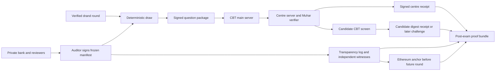

# Muhar digital architecture

Status: proposed architecture, 8 November 2026. The reference pilot is **one centre, one session, synthetic questions, and an existing computer-based testing (CBT) interface**. Live questions and high-stakes use need institutional approval and an independent security review.
## Product boundary
Muhar is an **integrity control plane** beside a CBT delivery system. Muhar fixes the rules, verifies the draw, authorizes and records paper release, and produces evidence. The CBT system handles registration, identity, candidate display, responses, scoring, and accommodations. This boundary matches the main-server → authorised centre-server → candidate-computer path described in India's 2024 Public Examinations Rules; [DoPT's accessible summary](https://persmin.gov.in/DOPT_achievements_2014-2025/InnerFiles/Current_Year_PDF/2025.pdf) confirms the Rules' incident and monitoring framework. An [NTA CBT tender](https://nta.ac.in/Download/Tender/Tender_20260302181817.pdf) illustrates operational needs such as full-node mocks, backup power, secure local networks, and independent connectivity. Its terms apply to that procurement, not automatically to every Muhar pilot.
The interface between the two systems is a small, versioned adapter: it accepts a signed paper package, returns a signed receipt for the package digest, and exposes the full digest, form ID, and chosen language/accessible variant to the candidate interface. The CBT import and start paths must **reject** an unsigned package, a digest mismatch, or an unexpected form. They record the verified digest and variant in the private CBT session record. The first mock disables any CBT-side question or option reshuffling; a later per-candidate shuffle would require its own signed ordered-form mapping and digest. The adapter does not need candidate identity to perform the public verification.

## One session, from preparation to proof

| Phase | Action and evidence | Security decision |
| --- | --- | --- |
| 1. Author and review | Authors submit questions to a restricted bank. Independent reviewers inspect the wording, all language variants, images, equations, options, accessibility, tags, duplicates, and candidate-device rendering. An auditor signs the exact inventory root and blueprint. | An author or reviewer can still leak material they saw. Access must be compartmentalised and recorded. |
| 2. Announce session | The institution publishes one official opaque session ID and its authorized root-key fingerprint through an independently authenticated schedule/charter. The charter fixes admission, late-entry, release, cancellation, outage, disclosure, and key-rotation policies. | A self-signed manifest is not proof of official authority. Monitors flag parallel or conflicting advertised sessions. |
| 3. Freeze | Sign the exact manifest, append it and the auditor attestation to the public log, and finalize its Ethereum anchor in the charter's named one-time registry before the predetermined beacon round. Two independently operated witnesses sign the checkpoint and their observation of finalized anchor. | A late or unfinalized anchor fails verification. The centre caches both witness attestations and anchor reference; exam start never waits for an Ethereum RPC. |
| 4. Centre readiness | Centre officials attest power, network, tested devices, correct release software, and the declared admission status. | These are accountable human/device statements, not proof that a physical gate is closed. |
| 5. Draw | Fetch the committed future drand round from more than one source; verify its signature against a pinned chain identity; deterministically select IDs from the frozen inventory. | No automatic new round, local-clock seed, or operator-picked fallback. |
| 6. Build and release | Create a signed package containing exactly the selected, opened questions in draw order; transmit it over an authenticated encrypted channel to the CBT main server and centre. The CBT import/start handshake and centre verifier reject a mismatch; the centre signs the digest it received. | The package contains questions and assets, never answers or scoring secrets. A compromised centre remains a leak path. |
| 7. Candidate view | The CBT screen shows only the verified form and variant. The mock offers the full package digest, form ID, and variant as selectable, screen-reader-readable text plus an optional QR, and gives the candidate a signed printed exit receipt or an approved accessible retained format. | A retained receipt supports a challenge without a phone. It does not prove what an untrusted screen displayed. |
| 8. Close and disclose | After the last affected session, publish the permitted inventory, selected question openings, draw transcript, package digest, signatures, and log/chain proofs. Answer-key openings follow a separate schedule. | Never publish reusable questions, key material, personal reports, or response data early. |
| 9. Verify and investigate | Anyone replays the public draw. The bank auditor and exam authority can inspect restricted evidence. Candidates use the operator's grievance route. | A proof failure triggers investigation; Muhar does not decide guilt or exam cancellation. |

The [October 2026 parliamentary committee](https://www.pib.gov.in/PressReleseDetailm.aspx?PRID=2321420&lang=1&reg=1) recommends papers set close to exam time, CBT mocks, independent security auditing, accessibility measures, and a publicly explained normalisation method for multiple sessions. It also recommends allowing some late candidates to enter. Consequently, **“gates close” cannot be a universal cryptographic trigger**. The actual admission rule must be fixed in the session charter. For the first mock, admissions end before the public seed. Later deployments must choose and review a permitted late-entry boundary, a separately equated form, or an explicitly accepted leak window. The latter two choices require psychometric and operational review.

A late draw leaves little time to inspect the assembled form. Every eligible item and language/rendering variant must therefore be reviewed on representative candidate devices **before freeze**, and the assembled form must pass automatic completeness and duplicate checks. If a real operator requires human review of the final form, that review needs a measured time buffer and controlled/sequestered reviewers; the longer buffer also increases the leak window. The pilot measures the actual draw-to-release time before fixing production timings. A real no-phone exam also needs an institution-approved printed or similarly independently retained receipt/challenge route; a portal record controlled only by the operator is weaker evidence.

## Minimal protocol objects

All public objects are versioned and signed. The implementation specification must pin a canonical encoding and test vectors; [RFC 8785](https://www.rfc-editor.org/rfc/rfc8785.html) is a starting point for JSON, with explicit schema restrictions for Unicode, numeric fields, size limits, and assets. This file defines the fields and claims, not final wire bytes.

| Object | Essential fields | Public timing |
| --- | --- | --- |
| `SessionCharter` | Official session ID; institutionally authenticated operator root-key fingerprint and rotation rule; auditor/witness keys; canonical Ethereum chain ID, immutable registry address/code hash; admission and late-entry rules; cancellation quorum; outage and disclosure policy hashes | Before freeze |
| `InventoryRecord` | Random opaque item ID; exactly one selection stratum; `question_commitment`; `answer_commitment` | Root before round; full records only at allowed disclosure |
| `Manifest` | Protocol/schema and draw version; charter hash; ordered inventory root/count; fixed quotas; exact drand chain hash/public key/scheme/round; expected Ethereum network/registry; approved software digest | Signed, audited, logged, and anchored before round |
| `AuditorAttestation` | Exact manifest hash, scope of bank/metadata review, auditor signature | Before round |
| `DrawTranscript` | Manifest hash, verified beacon signature and value, selected ordered IDs, algorithm result | After round; public when disclosure allows |
| `PaperPackage` | Session/form ID; draw-transcript hash; ordered questions and options; translations, media hashes, accessibility assets, renderer/version, hashes of the exact rendered HTML/PDF/assets delivered; package digest; operator signature | Released privately to authorised CBT path; public digest delayed until disclosure |
| `CentreReceipt` | Session/form ID; package digest; centre alias; software/build digest; signed receipt and claimed time | Private at release; public redacted copy only after the last affected session |
| `ProofBundle` | Manifest, relevant inventory openings, beacon proof, paper digest, receipts, log inclusion/consistency proofs, Ethereum finalized anchor reference | After applicable sessions and disclosure gate |

Use **one ordered inventory root** over records that bind IDs, selection tags, and independent question/answer commitments. Each selected question opening includes its random salt and canonical package and proves inclusion against that frozen root. Bind every content commitment to the protocol version, session ID, and item ID. The answer key has its own salt and opening date. A hash of a selected ID alone cannot catch a swapped diagram, translation, answer option order, or rendering rule.

The public log may publish a domain-separated salted hiding commitment to the paper-package digest and session ID at release, with its fresh random salt disclosed only after the last affected session. Keep the bare digest and centre/candidate receipts private until then: a guessable set of possible forms could otherwise be identified by hashing each candidate form. The signed private receipts and later salt opening bind the delayed public proof to the release event.

The first draw supports fixed quotas over disjoint strata. The spec must define the exact random-byte derivation, unbiased integer sampling, ordering, and impossible-quota failure. An independent implementation must reproduce the same result from the published transcript. The [drand specification](https://docs.drand.love/docs/specification/) provides signature-verifiable rounds; the verifier checks the signature and pinned chain identity instead of trusting an API response.

## Claims the verifier may make

The public verifier reports each claim independently, with `VERIFIED`, `FAILED`, or `INCOMPLETE` and the evidence used:

1. `FROZEN_BEFORE_SEED`: one authorised manifest and auditor attestation for the official session ID were finalized before the committed round **in the named canonical registry**. The verifier checks the institutionally pinned signing key, chain ID, registry address and code hash, witnessed log checkpoint, and finalized anchor. This does not establish that no document was posted elsewhere.
2. `DRAW_REPRODUCED`: the revealed ordered inventory, blueprint, signed beacon round, and algorithm produce the published selected IDs.
3. `SELECTED_CONTENT_OPENED`: each disclosed selected question package matches its pre-round commitment. Answer-key claims are separate.
4. `PAPER_MATCHES_DRAW`: canonicalize the actual released package; compare every question, language/media asset, option order, and form position with the opened selected items in draw order; verify exact rendered-file hashes; then recompute its digest. The first mock has no hidden CBT reshuffle. A matching hash still cannot prove that an untrusted screen displayed the bytes correctly.
5. `LOG_CONSISTENT`: inclusion and consistency proofs match checkpoints saved by an independent witness and the Ethereum anchor; the data is retrievable.
6. `DELIVERY_ATTESTED`: operator, CBT adapter, and centre signatures identify the package digest they claim to have distributed and received. Candidate receipts can support a specific display challenge.
7. `BANK_AUDITOR_ATTESTED`: an independent named auditor states its review scope for the frozen inventory and blueprint. The public root does not prove academic quality or absence of duplicates.

There is no top-level **“exam secure”** result. A signed event can be false, a centre can display different pixels, and an author can leak a remembered question. The verifier shows the boundary of each proof so the operator, candidates, and investigators can act on evidence without mistaking it for a physical guarantee.

## Release and connectivity decisions

**Pilot choice:** online release to one centre with a predeclared maximum delivery time. The centre preloads the manifest, two signed independent-witness attestations bound to its finalized checkpoint/anchor, institutionally pinned signer keys, and verifier binary; it fetches only the beacon proof and signed selected-paper package near exam start. Each witness independently checks Ethereum finality, using separate infrastructure where feasible. The centre validates the local signatures and beacon proof. Public verifiers later check Ethereum finality independently; the centre does not need a live Ethereum node. An authenticated encrypted channel, package signature, and fail-closed CBT import/start handshake prevent a network intermediary or ordinary CBT configuration error from silently changing the form. Use two separately operated beacon relays for availability, but accept a round only when its cryptographic signature verifies.

| Failure | Pilot response | Why |
| --- | --- | --- |
| Ethereum RPC unavailable at start | Continue using two cached signed witness attestations bound to the finalized checkpoint/anchor | Independent witnesses checked the anchor before the seed; public verifiers recheck finality after the exam. |
| One beacon API unavailable | Try independent relay for the **same round**; verify the signature | A relay supplies bytes, not trust. |
| Committed beacon round unavailable after the charter's deadline | Postpone/cancel under the signed charter and log the incident | Choosing another round after seeing circumstances creates a retry channel. |
| Centre link or power fails before signed package receipt | Pause or postpone that mock session under the charter | A centre cannot receive a future paper without a trusted channel. |
| Centre or candidate digest disagrees | Stop release at that centre, preserve restricted evidence, escalate to the operator | An unexplained mismatch defeats the delivery claim. |
| Operator cancels after the seed | Require independent quorum, public reason, linked replacement ID, and after-action review | Prevent drawing repeatedly until a favoured result appears. |

Prepositioning encrypted questions on centre machines is a **separate design**. It can improve availability but places more secret material on devices that may be stolen or compromised. A fully offline centre cannot receive a genuinely future beacon value or release key without a trusted alternate channel, clock/hardware assumption, or prepositioned secret. Design and audit that tradeoff before promising offline starts. Public-beacon [timelock encryption](https://docs.drand.love/docs/timelock-encryption/) does not govern live release: anyone holding ciphertext can decrypt it once the scheduled round appears. A later threshold release must be reviewed and must ensure **no single actor, including the operator, auditor, or bank administrator**, already holds a readable full bank; otherwise that actor can reconstruct the selected paper when the public seed appears.

## More than one centre or shift

The first pilot has one centre because a common paper at many centres creates a global timing problem: one late or compromised centre can leave other candidates waiting or expose a paper to people still eligible to enter. A national deployment needs a predeclared synchronized-release/late-centre policy or distinct forms with independently reviewed difficulty and normalisation. The latter is a professional assessment-design task as well as a software task. Any later shift that reuses items changes the disclosure schedule and leak risk; question openings wait until every affected shift is complete. Accommodations, scribes, extra time, languages, and late entry are part of the signed operating policy, not ad hoc overrides. [GIGW 3.0](https://guidelines.india.gov.in/focus-areas/) and [QTI 3 accessibility guidance](https://www.1edtech.org/standards/qti/accessibility) are useful for government-facing interfaces and a future content adapter; the CBT delivery app still needs real-device accessibility testing.

## Privacy and evidence custody

The public log and Ethereum carry only non-sensitive commitments, signed policy events, proof references, and redacted outcomes. A restricted evidence vault holds names, seat/device mappings, raw centre logs, grievances, response data, and incident exhibits. Give it access control, encryption, export for the responsible authority, retention/deletion rules, and an audit trail. The public verifier needs no candidate login. Any candidate-specific receipt or challenge stays within the operator's private CBT/grievance system. The [DPDP commencement notice](https://www.meity.gov.in/static/uploads/2025/11/c56ceae6c383460ca69577428d36828b.pdf) phases data-protection duties, and [CERT-In's directions](https://cert-in.org.in/Directions70B.jsp) affect covered operators' incident and log processes; the adopting institution must map its obligations.

## Security layers for live questions

| Boundary | Required control before a live-secret pilot | What remains possible |
| --- | --- | --- |
| Question bank | Per-item access, independent review, encryption, hardware-backed key custody, and an access trail; assess whether any author, auditor, or administrator can reconstruct the full bank. | A person can leak an item they legitimately saw. |
| Source to binary | Two independent reviews for sensitive code, pinned dependencies, signed build provenance, reproducible releases, and verification by a separate trusted installer. | A compromised maintainer or build environment can still attempt a malicious release. |
| Central release | Authenticated operator key, reviewed quorum/key ceremony, signed package, strict session/form binding, and logged exceptional actions. | A quorum can collude, and the release service handles plaintext at release. |
| Centre devices | Controlled software image, secure/measured boot where available, external release verification, network segmentation, restricted peripherals, power and link backups, and full-duration mock testing. | A dishonest official or compromised endpoint can still copy or misdisplay content. |
| Public oversight | Two independent witnesses, mirrored proof bundles, public verifier, restricted incident vault, and an official challenge route. | A truthful log cannot prove that every physical statement was true. |

These controls use open code and public protocol rules while keeping exam secrets, deployment credentials, and private evidence restricted. Their detailed implementation and acceptance tests belong in the adopting institution's security plan; Muhar's public proof must state which controls were actually checked.

## Build order and exit tests

1. **Protocol review:** freeze the object schemas, official session-ID rule, one-time manifest rule, disjoint-stratum draw, disclosure schedule, and negative test vectors. Have an external cryptography/security reviewer challenge the design before using live questions.
2. **Pure CLI:** build `muhar commit`, `muhar draw`, and `muhar verify` with synthetic questions. A second implementation verifies the published vectors. Tampered item, paper whose questions differ from valid selected openings, wrong language asset, wrong option order, invalid beacon signature, and another session ID must fail.
3. **Evidence layer:** add a reviewed transparency-log implementation, two independent witnesses, mirrored proof bundles, and a testnet Ethereum anchor. Verify that parallel manifests in the named registry, late finality, deleted events, and a log split are detected.
4. **CBT adapter:** integrate with one mock CBT server and one centre sidecar. Require a fail-closed import/start handshake, disable vendor-side reshuffling, store the digest in private CBT records, issue readable signed printed exit receipts, and drill a centre outage and digest mismatch.
5. **Public mock:** run a one-centre digital test with synthetic/retired items. Publish the permitted proof bundle; invite outsiders to reproduce the draw and submit challenges. Measure release latency, verifier success, failed/incomplete checks, accessibility, and incident resolution.
6. **Live-secret gate:** require partner agreement, bank-compartment design, release-key review, full-device security assessment, privacy review, and documented postponement authority before any real question is used.

The digital solution succeeds first by producing **independent, comprehensible evidence of a correctly frozen and executed draw**. Greater confidentiality requires harder operational work: who can read the bank, who controls the release, what happens at an offline centre, and how late or accommodated candidates are treated.
