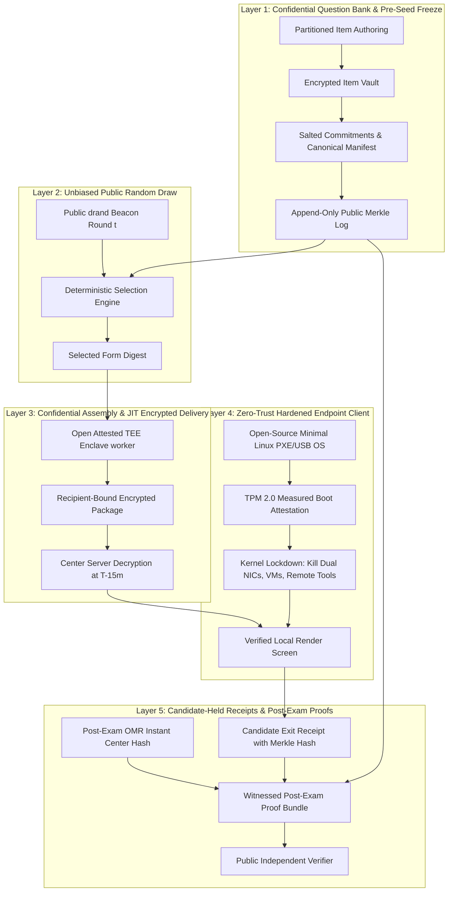

# Open-Source Verifiable Architecture for Exam Integrity
## Solving the "Black Box" Trust Crisis: From Blind Faith to Cryptographic Proof

**Status**: Technical Blueprint & Core Paradigm Specification  
**Project**: Muhar (मुहर)  
**Target Systems**: Computer-Based Testing (CBT), Pen-and-Paper (OMR) Custody, and Decentralized Question Packaging

---

## 1. Executive Problem Statement: The Fallacy of Proprietary "End-to-End Security"

For decades, testing authorities (e.g., NTA, State PSCs, commercial exam vendors) have claimed that their examination pipelines are protected by **"Proprietary End-to-End Security"**. Vendors routinely advertise:
- *"256-bit AES military-grade cloud encryption"*
- *"AI-powered continuous facial biometric invigilation"*
- *"Proprietary locked-down safe exam browsers"*
- *"Tamper-proof physical trunk boxes with barcode seals"*

### The Fatal Flaw: Unverifiable Security (Security Through Obscurity)
In practice, **no candidate, court, or independent auditor can verify whether these proprietary systems are actually secure**. The public is expected to grant **blind trust** to a black box. 

When high-stakes exams fail (e.g., NEET-UG paper leaks, JEE Main remote-desktop proxy rackets, SSC CGL lab compromises, Vyapam answer-sheet swaps), closed-source systems produce no admissible, public forensic evidence. Instead:
1. **Insiders with Database Access**: A vendor database administrator or corrupt cloud operator can alter answer keys, student responses, or center allocations undetected because audit logs are proprietary, mutable, and stored on centralized private servers.
2. **Endpoint Collusion**: Proprietary "secure browsers" fail because unvetted commercial testing centers install virtual machines, secondary network interface cards (NICs), or background remote-desktop tools (AnyDesk, UltraViewer) that allow external "solver gangs" to take exams on behalf of students.
3. **Paper & Vault Leaks**: In physical exams, paper sets are printed weeks in advance in private printing presses or stored in commercial bank vaults with zero cryptographically verifiable chain-of-custody.
4. **Post-Exam OMR Tampering**: Answer sheets left intentionally blank during the exam are filled in after hours by center staff before shipping (the "Godhra racket"), because no decentralized digital fingerprint is established at $T+0$.

When challenged in court, vendors hide behind Non-Disclosure Agreements (NDAs), proprietary source code, and unsubstantiated vendor claims. **If an end-to-end security architecture cannot be independently verified by the governed public, it is not secure—it is merely unaccountable.**

---

## 2. The Core Philosophy: Why Open-Source Verifiability is Objectively Superior

The fundamental axiom of modern information security is **Kerckhoffs's Principle (1883)**, reformulated by Claude Shannon as **Shannon's Maxim (1949)**:
> *"The enemy knows the system. A cryptographic system should be secure even if everything about the system, except the key, is public knowledge."*

Closed-source proprietary exam systems violate Kerckhoffs's Principle: they rely on keeping their code, network architecture, and operational flaws secret. When an adversary discovers a vulnerability, they exploit it silently for years across millions of candidates.

### The Open-Source Advantage in High-Stakes Public Governance

```
┌───────────────────────────────────────────────────────────┬───────────────────────────────────────────────────────────┐
│               Proprietary "Black Box" Model               │               Open-Source Verifiable Model                │
├───────────────────────────────────────────────────────────┼───────────────────────────────────────────────────────────┤
│ • Security depends on secrecy of code and vendor honesty. │ • Security depends on open mathematics & public physics.  │
│ • Audit trails are private, mutable, and vendor-owned.    │ • Audit trails are append-only, cryptographic, immutable. │
│ • Candidates must trust an unaccountable monopoly.        │ • Candidates hold verifiable digital proofs (receipts).   │
│ • Backdoors & remote-access tools remain hidden.          │ • Reproducible bit-for-bit builds expose any backdoor.    │
│ • Courts receive contradictory vendor assertions.         │ • Courts receive mathematically unforgeable evidence.     │
└───────────────────────────────────────────────────────────┴───────────────────────────────────────────────────────────┘
```

In an open-source verifiable architecture:
1. **The Code is the Law**: Every algorithm (random selection, question packaging, time-locks, Merkle tree hashing, device attestation) is open on GitHub for academic, judicial, and adversarial scrutiny.
2. **Zero-Trust by Design**: We do not assume the exam authority, the IT vendor, the center superintendent, or the proctor is honest. The architecture is engineered so that **even if every intermediary is corrupt, they cannot cheat without generating incontrovertible cryptographic proof of failure**.
3. **Reproducible Bit-for-Bit Builds**: Open-source allows deterministic compilation. Anyone can verify that the binary running on candidate terminals or server enclaves was compiled from the exact, unadulterated open source code.

---

## 3. The End-to-End Open-Source Technical Architecture

Muhar structures the end-to-end exam pipeline into **Five Open-Source Verifiable Layers**. Each layer eliminates a specific attack vector using open cryptographic standards.



---

### Layer 1: Partitioned Question Bank & Pre-Seed Freezing

* **The Problem**: Whole-bank exports to coaching syndicates or database theft by IT administrators.
* **Open-Source Solution**:
  1. **Item-Level Micro-Vaults**: Questions are authored in isolated, compartmented micro-vaults. No single author or database administrator ever has full-bank read access.
  2. **Salted Cryptographic Commitments**: Every item $i$ is committed as:
     $$C_i = H(\text{item\_id} \parallel \text{content} \parallel \text{asset\_hashes} \parallel \text{salt}_i)$$
  3. **The Session Manifest & Witnessed Log**: The testing authority compiles all eligible item commitments into an authenticated canonical manifest. This manifest is appended to an open-source, append-only **Merkle Transparency Log** (compliant with the C2SP checkpoint standard).
  4. **Multi-Institutional Witness Cosigning**: The log checkpoint is cosigned by independent institutional witnesses (e.g., IIT Computer Science Depts, High Court Registrars, State IT Bodies). An exam cannot proceed unless independent witnesses certify the exact tree state **before** the selection seed is known.

---

### Layer 2: Unbiased Public Random Selection (drand)

* **The Problem**: Operators cherry-picking favorable questions or exam syndicates predicting test forms.
* **Open-Source Solution**:
  1. **Distributed Randomness Beacon (`drand`)**: The selection seed is tied to an immutable future round $R$ of the global public `drand` network (operated by a consortium including Cloudflare, EPFL, Protocol Labs, Kudelski Security).
  2. **Mathematical Impossibility of Pre-Computation**: Until round $R$ occurs, no entity on Earth can predict the threshold BLS signature.
  3. **Deterministic Selection Engine**: The selection algorithm is an open-source, mathematically pure function:
     $$\text{SelectedItems} = \text{DeterministicDraw}(\text{ManifestCommitments}, \text{drand\_signature}_R, \text{Blueprint})$$
     Any student, journalist, or judge can download the open-source CLI, input the public commitments and the public drand seed, and reproduce the exact 180 questions drawn in under 100 milliseconds.

---

### Layer 3: Confidential Assembly & JIT Encrypted Delivery

* **The Problem**: Human leakage during the window between question selection and exam start.
* **Open-Source Solution**:
  1. **Attested Confidential Computing (TEEs)**: The assembly worker runs inside an open-source Trusted Execution Environment (e.g., AMD SEV-SNP or Intel SGX) using a verifiable Linux container.
  2. **Remote Attestation**: Before releasing decryption keys, independent key holders verify the cryptographic hash of the enclave's memory measurements (*measurement digest*). If a system administrator has attached a debugger or modified the kernel, the enclave fails attestation, and keys are refused.
  3. **Just-in-Time (JIT) Delivery ($T-15\text{m}$)**: The assembled, watermarked package is encrypted specifically to the public key of the authenticated center hardware and released only 15 to 30 minutes before testing starts, eliminating long transit and warehouse storage windows.

---

### Layer 4: The Zero-Trust Hardened Endpoint Client (Open OS)

* **The Problem**: The "AnyDesk / Lab Collusion" epidemic. Commercial CBT labs connect candidate terminals to hidden local servers or external solver networks via secondary network cards, virtualization, or remote-desktop software.
* **Open-Source Solution**:
  1. **Stateless, Ephemeral Boot Image**: Candidates' test terminals do not run the testing lab's compromised Windows OS. Instead, machines boot via PXE (Network Boot) or immutable USB into a minimal, open-source Linux kernel (e.g., tailored Alpine/CoreOS).
  2. **TPM 2.0 Measured Boot**: The terminal's hardware Trusted Platform Module (TPM) measures the entire boot chain (BIOS, bootloader, kernel, filesystem). The Muhar local agent will refuse to display the exam unless the TPM quotes prove the system booted an unmodified, official open-source OS image.
  3. **Kernel-Level Hardware Lockdown**:
     - *Display*: Physical EDID check; disables secondary video outputs (HDMI splitters/capture cards).
     - *Network*: Enforces strict firewall rules (`nftables`); blocks all traffic except the air-gapped local examination server; disables secondary Wi-Fi and Bluetooth NICs.
     - *Process Space*: Runs a single, full-screen kiosk process without a desktop shell, command line, or background daemon capability.

---

### Layer 5: Post-Exam Response Integrity & Verifiable Proofs

* **The Problem**: Post-exam tampering (altering vendor databases, filling blank OMR sheets in transit, or destroying answer keys).
* **Open-Source Solution**:
  1. **For CBT (Candidate-Held Proofs)**:
     - Upon submission, the terminal generates an open-source **Session Exit Receipt**.
     - The receipt contains:
       $$\text{Receipt} = \text{Sign}_{\text{Terminal}}(H(\text{FormDigest} \parallel \text{CandidateID} \parallel \text{ResponseVector} \parallel \text{Timestamp}))$$
     - The candidate receives a physically printed or cryptographically signed receipt. If the testing vendor alters a candidate’s score in the central database later, the candidate produces their receipt, which mathematically contradicts the database.
  2. **For Pen-and-Paper (Decentralized Digital OMR Custody)**:
     - Instead of packing raw paper OMR sheets into vulnerable steel trunk boxes for multi-day courier transport, centers use on-site high-speed scanners.
     - Immediately at $T+0$ (in front of independent classroom observers), sheets are scanned.
     - The raw images are hashed into an on-site Merkle tree:
       $$\text{OMR\_Root} = \text{MerkleTree}(\{H(\text{sheet}_1), H(\text{sheet}_2), \dots, H(\text{sheet}_n)\})$$
     - The `OMR_Root` is immediately signed and published to the public append-only log *before* the physical papers leave the examination hall.
     - Any subsequent alteration of the physical paper or database entry creates an immediate, mathematically provable digest mismatch.

---

## 4. Answering the Ultimate Skeptic: "How Do We Know Even the Open-Source System is Secure?"

A fundamental premise of engineering is that **software alone is never infallible**. How do we guarantee that the open-source software itself has not been compromised?

| Skeptic's Challenge | Open-Source Verifiable Countermeasure |
| :--- | :--- |
| **"What if the open-source code has a hidden backdoor?"** | **Public Multi-Party Audits & Formal Verification:** The core protocol logic is written in minimal code (Go/Rust) and formally verified using TLA+ or Coq state-machine specifications to mathematically prove absence of deadlocks, unauthorized state transitions, and key-leakage paths. |
| **"What if the binary running on the server is different from the open-source GitHub code?"** | **Reproducible Bit-for-Bit Compilation:** Using Nix/Guix or reproducible Docker builds, any third party can compile the source code and achieve the exact cryptographic hash of the deployment binary (`sha256:abcd...`). Remote attestation logs prove the running hardware executed that exact hash. |
| **"What if the exam authority controls all the witness servers?"** | **Adversarial Institutional Federation:** Witness keys are distributed among adversarial entities who do not trust each other (e.g., IITs, State Public Service Commissions, National Bar Councils, and Student Union Technical Committees). Collusion requires a multi-institutional conspiracy. |
| **"What if the drand randomness is compromised?"** | **Multi-Source Randomness Anchoring:** The protocol can hash together multiple independent public entropy sources: $H(\text{drand\_beacon} \parallel \text{Bitcoin\_Block\_Hash} \parallel \text{NIST\_Randomness\_Beacon})$. Pre-computing multiple independent global entropy networks simultaneously is mathematically impossible. |
| **"What if the physical candidate terminal hardware is tampered with?"** | **Candidate-Retained Evidence:** Even if a terminal tries to cheat, it cannot forge the candidate's paper digest without invalidating the candidate's exit receipt. The candidate holds independent proof that can be challenged in any court of law. |

---

## 5. Implementation Roadmap: From Theory to Open-Source Reference Build

To demonstrate this architecture without requiring a multi-million-candidate national overhaul on Day 1, Muhar proceeds in **three verifiable milestones**:

```
[ Milestone 1: The Core Protocol CLI ]
  ├── muhar-bank: Open CLI to commit salted questions and verify manifest roots.
  ├── muhar-draw: Open CLI to ingest drand seeds and deterministically compute forms.
  └── muhar-log: Open append-only Merkle tree implementation with C2SP witness cosigning.

[ Milestone 2: The Hardened Bootable Client (PXE/USB) ]
  ├── Open-source immutable Alpine Linux build with TPM 2.0 measurement.
  ├── Automatic network isolation and display port lock down.
  └── Candidate exit-receipt generation engine.

[ Milestone 3: The One-Center Verifiable Mock ]
  ├── Run a 100-student mock exam with synthetic questions.
  ├── Publish full Merkle logs, witness checkpoints, and drand seeds publicly.
  └── Invite independent white-hat hackers, student reps, and journalists to verify proofs.
```

---

## 6. Conclusion: The Sovereign Imperative

The crisis of exam leaks in India and across the developing world is not an educational failure; **it is an architectural failure born of proprietary black boxes**.

When an exam system is closed, every leak destroys public trust, forces mass cancellations, triggers judicial paralysis, and ruins the lives of millions of hardworking youth. 

**Open-source, cryptographically verifiable technology is not an academic luxury—it is the only architecture capable of restoring public trust.** By replacing human discretion with cryptographic commitments, proprietary servers with append-only witness logs, and black-box claims with candidate-held mathematical proofs, Muhar provides the definitive blueprint for honest, sovereign exam governance.
