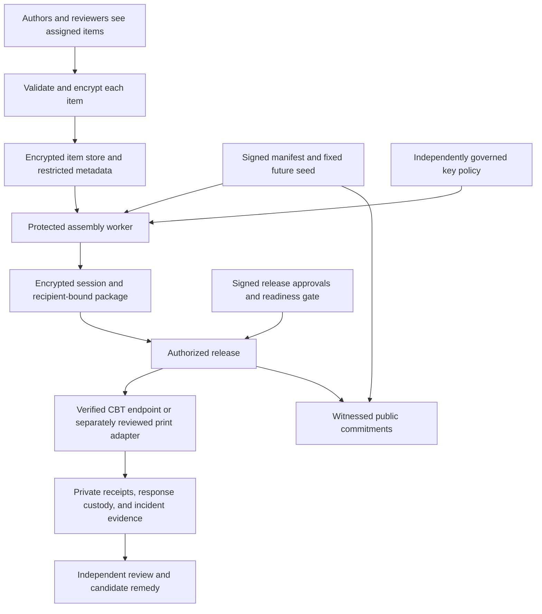

# Muhar: secure paper preparation and accountable examination delivery

**Revised proposal · 9 November 2026 · design only.** This revision incorporates the user's five constraints: CBT capacity, corrupt centre personnel, NEET/JEE scale, use across Indian examinations, and protection of the final paper before release. The [capacity evidence](research/INDIA_CAPACITY_EVIDENCE.md), [centre-case review](research/CENTRE_COLLUSION_REVIEW.md), and [sealed paper architecture](SEALED_PAPER_ARCHITECTURE.md) supply the detailed evidence and trust boundaries. No partner, implementation, hardware deployment, or live-exam result is claimed.

## The problem Muhar must actually address

An examination can fail at four different points: an insider obtains questions before the test; a centre helps selected candidates during it; answers or marks change afterward; or a correct procedure still disadvantages candidates through inaccessible centres, poor translations, unsuitable questions, or an invalid comparison across shifts. Protecting the question-paper file addresses only part of this chain. A correct signature can accompany a leaked paper or a corrupt invigilator.

Muhar should provide a reusable protocol for controlled paper preparation, declared release decisions, signed delivery and response records, and independent investigation. It should expose which claims were checked and which remain dependent on people, hardware, assessment expertise, or missing evidence. Its public verifier cannot certify the quality of a candidate or the fairness of an entire examination.

## Five constraints converted into decisions

The official 2026 releases report **22,79,743 NEET registrations** and **16,04,854 unique JEE Main Paper 1 registrations**, a derived ratio of **1.42×**. The comparable 2025 ratio is **1.48×**. NEET's 2026 attendance relates to a re-examination, while JEE's annual unique total spans two sessions. Neither annual ratio specifies simultaneous seat demand. See the definitions, source discrepancy, and capacity model in the [evidence ledger](research/INDIA_CAPACITY_EVIDENCE.md). Sources: [NTA NEET data](https://cdnbbsr.s3waas.gov.in/s37bc1ec1d9c3426357e69acd5bf320061/uploads/2026/07/202607161539405935.pdf), [NTA JEE release](https://nta.ac.in/Download/Notice/Notice_20260420194021.pdf).

| User concern | Interpretation required by evidence | Proposal decision | Checkpoint before adoption |
| --- | --- | --- | --- |
| Too few CBT centres | A venue count does not reveal usable seats, accessible seats, spare machines, geography, or available shifts. National simultaneous capacity remains an evidence gap. | Maintain a dated readiness inventory and a district-level demand/seat allocation model for each adopter. | A full-duration load and accessibility rehearsal on the actual booked fleet, with backups and travel constraints. Reject unsupported capacity claims. |
| Invigilators or centres help candidates for money | Documented cases support insider and vendor collusion as credible threats. They do not establish a national corruption rate or typical payment. | Treat local administrators, invigilators, vendors, and release staff as possible adversaries. Separate appointment, release, monitoring, and investigation authority. | A deliberately dishonest-centre drill must test what an independent observer can detect; centre self-attestation alone cannot pass this gate. |
| NEET is larger than JEE | Compare like years and units: unique registrations, unique appearances, and simultaneous sittings. JEE's reused seats across shifts cannot be compared directly to a single large sitting. | Plan against booked candidates at peak concurrency. Model extra shifts explicitly, including form quality, exposure between shifts, and normalization. | Publish a capacity calculation with actual centre measurements, reservations, buffers, accommodation seats, and failure scenarios. |
| The solution must generalize | Common custody and evidence rules can be reused; syllabi, languages, scoring, admissions, procurement, and appeal authority differ. | Build a common security protocol with versioned exam and delivery profiles. Keep rules owned by the adopting authority. | Replay the same protocol across at least two different synthetic exam profiles and reject cross-exam/session/tenant reuse. |
| No one should see the final paper early | Authors and reviewers necessarily see individual items; candidates and endpoints see released content. The enforceable target must name the actor and time boundary. | Make compartmented ingestion, encrypted items, protected assembly, and controlled release part of the **first synthetic prototype**. | Test preview, export, admin/key-policy bypass, crash dumps, rollback, unauthorized destinations, and release before the declared gate. |

The [October 2026 parliamentary recommendations](https://www.pib.gov.in/PressReleseDetailm.aspx?PRID=2321420&lang=1&reg=1) call for expanded government CBT infrastructure, rural access, practice tests, and audited normalization before a transition. They also identify centre security and candidate grievances. These are recommendations; they do not demonstrate that infrastructure has been built or that a transition is already operational.

## Capacity is a measured deployment constraint

For a simultaneous sitting, let `N` be candidates scheduled to attend, including approved accommodations. Each centre contributes only machines that are booked for this exam, functional, compatible with the signed software image, accessible where required, and supported by power, network, staffing, and tested recovery. Exclude reserved spares from usable candidate seats. Require the sum of those seats to cover `N` **and** feasible assignment within the adopter's travel/access policy. A national sum can pass while a district has no acceptable placements.

For multiple shifts, capacity is the sum of usable seat-slots over the actual timetable. A machine cannot be counted simultaneously for two exams, and extra-time accommodations can occupy it into the next shift. Recovery time, sanitization/reset, staffing, and cancelled-centre reserves reduce throughput. Compute each region separately before aggregating. Forecast registration changes and no-shows separately; do not allocate fewer seats because a previous re-exam had lower attendance.

More shifts create a second problem: earlier candidates can disclose content to later ones. Distinct reviewed forms require adequate bank size, controlled item reuse, language equivalence, and a justified equating/normalization method. Simple option shuffling does not solve that exposure. Muhar can bind the approved method and record its execution; assessment specialists must establish its validity.

The first release does not require every Indian exam to become CBT. An existing CBT adapter is the initial integration. A later controlled print adapter must separately account for decrypted printer memory, spool files, duplicate copies, paper custody, accessibility, and destruction. Delivering an encrypted file to a printer does not make the printed exam confidential indefinitely.

## The first technical iteration: sealed paper pipeline

The security target is **to prevent a single routine operational actor from previewing or exporting the assembled paper before the declared release, under explicit key-policy, application, and hardware assumptions**. The [architecture](SEALED_PAPER_ARCHITECTURE.md) details where that target fails. No promise of zero knowledge by every human, zero collusion, or protection after a compromised endpoint displays content is made.

1. **Compartment the bank from creation.** Assign authors and reviewers bounded item sets. Encrypt validated items promptly; separate questions, answer keys, metadata access, and approvals. Do not import an existing plaintext full bank and then claim that nobody has ever seen it. Audit cumulative access across assignments, exports, backups, contractors, and departing staff.
2. **Make academic review an explicit visibility decision.** Per-item review covers translations, media, accessibility, correctness, and difficulty labels. Final-form review may still be necessary. If a human must see the assembled form, use a signed review window and controlled reviewers; record the earlier exposure time and narrow the secrecy claim. Suppressing academic review to protect secrecy can produce an unusable or unfair exam.
3. **Assemble inside a restricted computation boundary.** A conventional server with an HSM can limit key export while still exposing decrypted content in host memory. The proposed confidentiality experiment uses an attested worker on suitable confidential-computing hardware; only approved code and configuration may obtain session-scoped keys. A simulator tests workflow, not resistance to a hostile host. Hardware/vendor flaws, vulnerable application code, side channels, and a compromised policy authority remain assumptions to review.
4. **Separate permission from cryptography.** The first prototype may require signed approval by two of three separately operated custodians. This is an application authorization quorum. It is not cryptographic threshold decryption unless a reviewed threshold construction actually keeps the secret unavailable below its threshold. Key-policy and administrator changes must not silently bypass the quorum.
5. **Bind release to exact recipients and policy.** Bind the session, manifest, form, endpoint key, software identity, release window, nonce/epoch, and approved delivery mode. The receiving key must be tied to the validated endpoint/worker, not supplied freely by a requester. No generic decrypt/download endpoint, plaintext emergency export, or alternate beacon chosen after seeing results. Freeze and review changes to the release policy and approved software identity.
6. **Preserve verifiable evidence without publishing secrets.** Use the small complete log, two independent checkpoint witnesses, separate content monitor, and later public scans from Iteration 2. The pre-start check remains provisional; preserve post-exam and post-appeal checkpoints. Keep candidate identities, responses, plaintext questions, keys, and raw grievance narratives out of public commitments and Ethereum.

A public random seed is not an access-control mechanism. Anyone holding a readable full bank plus the selection inputs can reconstruct the selected form when the seed appears. A whole-bank auditor, backup administrator, or master-export job can defeat release controls without touching the release service. Likewise, an Ethereum timestamp or a public timelock cannot enforce centre readiness or keep content hidden after its decryption time.

Even a partial bank can be enough when an actor knows all the items actually selected and can recover their order. Test overlapping review assignments and historical knowledge, not just master exports. Any selection constraint intended to bound an actor's known content must be independently assessed and committed before the draw; adaptive redraws would undermine the frozen selection rules. Without that assurance, claim prevention of new system-mediated preview/export while explicitly acknowledging reconstruction from prior knowledge.

Keep two separate secrecy questions in the acceptance report. **S1:** can an actor in the declared attacker set reconstruct the ordered form before the first authorized plaintext release? **S2:** after that release, can an earlier centre or candidate pass material to someone whose test has not started? Protected assembly targets S1. S2 needs timing, admission, centre conduct, and reviewed form-separation policies; a shared form released at one compromised centre defeats an unconditional S2 claim. Rehearse this with two simulated endpoints even when the first physical mock has only one centre.

## Corrupt centres require a second control boundary

The paper service may release the correct bytes to a centre that then supplies answers, permits a substitute candidate, alters a response, or enables remote assistance. Therefore readiness must include an independently verified installed image, restricted administrative/remote access, monitored network boundaries, controlled peripherals, attributable device/session credentials, external inspection, and evidence preserved outside the centre's sole control. Names and qualifications on an invigilator roster do not prove honest conduct.

Each institution must define conflict checks and appointment separation for centre staff and observers, secure reporting for candidates and staff, response-record custody, and investigation/appeal rights. Signed response snapshots and submission receipts can expose some later changes; they cannot prove who entered the answers when a device and invigilator collude. Biometrics, CCTV, and statistical anomalies are supporting signals with privacy and error risks. They must not automatically establish guilt or disqualify a centre's entire cohort. Cases and procedural findings need human review and a remedy proportional to the evidence. The [case review](research/CENTRE_COLLUSION_REVIEW.md) distinguishes allegations from judicial findings.

## Common protocol, explicit exam profiles

| Shared across adopters | Declared separately for each exam |
| --- | --- |
| Institution/exam/session identifiers and tenant isolation | Responsible authority, legal reporting, procurement, appeal and remedy owners |
| Canonical item commitments and signed manifests | Syllabus, question type, blueprint, language, accessibility, scoring and review rules |
| Restricted bank access and governed release | Admission, late entry, handoff time, accommodations, permitted delivery mode |
| Witnessed events, monitor reports, signed packages and private receipts | Shift structure, calibrated forms, normalization and content-reuse embargo |
| Independent verification, incident preservation and disclosure status | Candidate evidence schedule and applicable retention/privacy rules |

Start with fixed-quota, objective-question synthetic profiles for an entrance mock and an eligibility/recruitment-style mock. A second profile proves configuration reuse only; it does not validate a real recruitment authority. Descriptive, practical, adaptive, interview, and on-screen-marking workflows require new assessment and evidence adapters. Claim support only after their own tests. Cross-authority vendor history may be useful, but a national blacklist requires due process, reliable identity, correction, and appeal; Muhar cannot invent one from allegations.

## Mandatory acceptance checkpoints

| Gate / accountable owner | Evidence required | Failure decision |
| --- | --- | --- |
| G0 — authority and candidate representative | Signed profile, official keys/session, disclosure and complaint route, remedy owner | No invited mock until filled; local synthetic research may continue |
| G1 — capacity and accessibility lead | Booked usable seats and spares by district/shift, full-duration fleet rehearsal, accessibility/travel and outage plan | Reduce scope or postpone; extra shifts require assessment review |
| G2 — bank and academic leads | Cumulative access map, item/translation review, no routine whole-bank export, overlap test for partial knowledge of selected items, documented form-review visibility | Fail whole-form secrecy claim if a single actor can reconstruct the form; repair with reviewed precommitted constraints or narrow the claim |
| G3 — independent security reviewer | Attestation/key-policy binding, below-quorum refusal, host/admin and policy-change tests, secret-free logs/backups, anti-replay/rollback tests | No live secrets; simulation alone cannot pass hardware isolation |
| G4 — release and evidence leads | One manifest, fixed round, full log scan, both witnesses, fresh monitor status, exact recipient and release-window checks | Pause, preserve evidence, link any replacement session |
| G5 — centre operator plus independent observer | Verified software/keys, readiness, signed package, remote-access controls, dishonest-centre and response-tamper drills | Quarantine affected path; invoke predeclared continuity/remedy policy |
| G6 — assessment lead | Valid forms, language/access equivalence, shift comparison method and item-reuse policy | Do not treat cryptographic success as a valid score comparison |
| G7 — case reviewer | Usable proof before challenge deadline or timely restricted review, case receipt, reasoned decision, final witnessed outcomes | Candidate-actionability gate fails if cases cannot be answered |

## Build order and decision to continue

The first engineering artifact is a synthetic bank-to-release demonstrator with adversarial fixtures: unauthorized item export, unauthorized worker, stolen backup, policy downgrade, missing approval, early release, replay to another session/device, host crash, leaked logging, and a centre that lies. Build the deterministic draw and independent verifier alongside it. Compare a conventional isolated service with an attested assembly worker using the same synthetic workload so any additional protection is demonstrated against a named attacker.

Then connect one mock CBT interface, rehearse both handoff schedules, exercise a candidate complaint, and publish a claim-by-claim result. Repeat with a second exam profile. Expansion follows measured capacity and assessment readiness. Ethereum remains one optional shadow commitment over the pre-seed record; it does not gate paper release or substitute for a secrecy test. No token or candidate wallet is needed.

Continue only if the experiment demonstrates fewer unauthorized plaintext paths, repeatable refusal of invalid release requests, recoverable operations, independent evidence when a centre lies, and an accountable candidate response. Any claim of nationwide leak prevention, zero insider access, or certified social fairness remains unsupported by this proposal.
