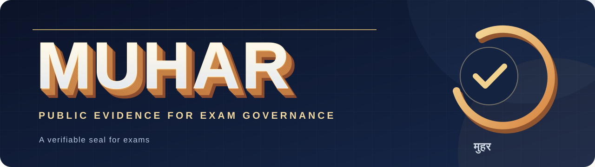

# Muhar (मुहर)

**Controlled paper preparation, accountable release, verifiable evidence.**

An exam asks students to trust a private chain of decisions: which questions were eligible, when the rules were fixed, how the paper was chosen, what reached each centre, and what happened when something went wrong. **Muhar proposes open-source controls for confidential paper preparation and release, backed by an independently checkable evidence protocol.** Its scope includes entrance, recruitment, eligibility, and university examinations. Exam authorities retain their own assessment, admissions, scoring, and remedy policies.

The idea grew from Devcon 8 India's [“What Can Ethereum Do for India? The Exam Leak Challenge”](https://cfp.devcon.org/devcon8/talk/QB3PET/). The [October 2026 parliamentary committee recommendations](https://www.pib.gov.in/PressReleseDetailm.aspx?PRID=2321420&lang=1&reg=1) likewise call for large reviewed question banks, papers assembled close to the exam, independent audits, secure grievances, and attention to real centre and candidate constraints. Neither source endorses Muhar.

> **Status:** design proposal. There is no deployable exam software here, no institutional partner, and no claim of affiliation with an exam authority.

## The problem, stated narrowly

The [revised proposal](PROPOSAL.md) treats five constraints as acceptance gates: usable CBT seat capacity, corrupt centre staff, the difference between annual candidates and simultaneous demand, use across different exams, and controlled visibility of the final paper. The first technical prototype now includes a sealed paper pipeline using synthetic questions. [Its architecture](SEALED_PAPER_ARCHITECTURE.md) defines exactly which humans and machines see plaintext and where confidentiality can fail.

“No one can see the paper” needs a precise scope. Authors and reviewers see assigned questions; candidates must see the released form. The proposed target is **no authorized human preview or export of the assembled form before its declared release**, with compartmented bank access, protected assembly, and independently governed key release. A conventional server administrator can still inspect ordinary process memory; a confidential-computing design adds hardware, attestation, application, and key-policy trust. This is an unimplemented security target, not a guarantee.

For one publicly announced exam session, can independent parties establish that **the named public log contained exactly one authorised frozen inventory and rule set before a future random draw; the released paper followed those rules; and later exceptions remain visible?** Can a candidate obtain the evidence in time to challenge it and receive an accountable response? This is a claim about the named system and the inspected log prefix, not a claim that no other copy or secret decision existed anywhere.

That is a coordination and governance problem as well as a cryptographic one. Authors, bank curators, exam operators, software vendors, centre staff, auditors, and candidates see different parts of the process. A signature proves that a key signed a statement; it cannot prove that a person spoke truthfully, that a screen displayed the signed bytes, or that the questions were fair.

| Devcon lens | Design response |
| --- | --- |
| **Governance** | The operator owns decisions; a public charter fixes authority, exceptions, challenges, and remedies. |
| **Real world** | Centre devices, late entry, accessible delivery, outages, and human custody are explicit trust boundaries. |
| **Coordination** | Operator, bank auditor, witnesses, and candidates work from one named session and a visible event history. |
| **Decentralisation** | Distribute evidence retention and checking where it helps; keep legal exam operation with an accountable institution. |

## What a verifier could say

| Question after the exam | Evidence Muhar proposes | What still needs human trust or review |
| --- | --- | --- |
| Were eligibility rules and the question inventory fixed before the draw? | An institutionally authenticated, signed manifest; a complete small log scanned for duplicate freezes; two witnesses retaining the same pre-seed checkpoint; and a preselected future beacon round. | A witness signature proves log consistency, not that it inspected the content. Pre-seed timing depends on independently retained contemporaneous evidence; the bank auditor must assess whether eligible items and labels were honest. |
| Was the paper drawn by the published rules? | A deterministic replay using the disclosed ordered inventory, blueprint, algorithm, and [signature-verified beacon](https://docs.drand.love/docs/specification/). | If the reusable inventory cannot be disclosed, this claim becomes **auditor-attested**, not publicly reproduced. |
| Was that paper sent to the centre? | A signed full paper package, exact content and rendered-file hashes, and operator and centre receipts. | A compromised centre can still misdisplay or copy the paper. Receipts are claims about delivery, not proof of pixels. |
| Was there no leak, and was the exam fair? | **Muhar cannot certify either claim.** | Insider access, question quality, translations, accommodations, scoring, investigation, and remedies need separate controls. |

The public verifier should report each check as `VERIFIED`, `FAILED`, or `INCOMPLETE` with its evidence. It must never collapse them into an “exam secure” badge.

## One session, from private bank to public evidence

```text
Reviewed private question bank
         │  salted item commitments + signed blueprint
         ▼
One frozen session manifest ──► small witnessed log + full-scan monitor ──► shadow Ethereum checkpoint
         │
         ▼
Precommitted future beacon round ──► deterministic draw
         │
         ▼
Signed paper package ──► controlled CBT import and centre receipt
         │
         ▼
Post-exam disclosure ──► independent replay, challenge, and accountable response
```

One legally accountable exam operator still decides whether to run, pause, or cancel the exam. Independent institutions review declared bank controls and witness the record. The first sealed prototype separates release approvals among custodians; cryptographic threshold decryption would require a separately reviewed implementation. Candidates need no wallet. Question text, answer keys, candidate data, and release secrets stay off-chain. A cancellation after the draw must be signed, explained, linked to any replacement, and reviewed: otherwise the operator could keep redrawing until it likes the result.

## Does this need Ethereum?

That is an experiment, not an article of faith. [Standard log witnesses check checkpoint consistency](https://c2sp.org/tlog-witness@main); an independent monitor must inspect the leaves and a public verifier must be able to repeat that scan. Ethereum may add a neutral checkpoint when institutions do not fully trust one another. A transaction in a block before the seed and finalized *later* does not prove it was finalized *before* the seed; the research arm must retain evidence for that stronger timing claim or report `INCOMPLETE`. A chain cannot authenticate an exam authority, restore missing log leaves, or prove an off-chain fact. There is no case for a token, candidate wallet, DAO, or new chain.

The first mock should use **a small, complete witnessed log as its declared operational evidence profile**. Two separately operated witnesses must cosign the same checkpoint; an independent content monitor scans every leaf, and the verifier recounts freezes for the official session. A missing cosignature pauses the mock under its declared policy. The pre-start scan is a **provisional start gate**: the monitor stays active through the seed and start, and a later witnessed full scan must confirm the final one-freeze result. Anchor the pre-seed checkpoint on Ethereum in a **research-only shadow arm**. The anchor covers that prefix only; later cancellations and grievance outcomes rely on later retained log checkpoints, including one after appeals close. The shadow result cannot authorize the exam or rescue a failed baseline check. Inject a duplicate freeze, a conflicting history, and a late anchor; compare detection, proof availability, cost, finality delay, and operating burden. A per-session authenticated map is a possible later scale optimization, with its own log-to-map transition proofs. If Ethereum adds no meaningful protection, keep it out of the required path.

## Hard objections before a real exam

1. **Prior knowledge bypasses release locks.** Once selection inputs are known, a full-bank insider can derive the paper; a partial-bank reader can also do so if they know all selected items and their order. Check cumulative and overlapping review access. Bank compartments, access control, short release windows, and human custody matter more than a chain transaction.
2. **Correct randomness does not mean a fair paper.** Academic review, duplicate detection, language equivalence, psychometric calibration, and multi-form score comparability remain independent gates.
3. **“Independent” parties may depend on the operator.** The charter must name how auditors and witnesses are appointed, funded, rotated, challenged, and replaced, and who must answer a candidate's grievance.
4. **Failing closed can hurt candidates.** A beacon, power, or network outage may force a postponement. Late entry, disability accommodations, rural connectivity, and centre failures need a published policy and a remedy path.
5. **A mock cannot prove national readiness.** A one-centre test with synthetic items can validate protocol behaviour and candidate comprehension. It cannot validate live bank secrecy, collusion resistance, assessment quality, or nationwide operations.
6. **A proof can arrive too late to help.** The mock charter must make a procedural-integrity challenge possible after complete proof disclosure. If a real reusable bank cannot be opened before the relevant remedy deadline, a genuinely independent reviewer must inspect restricted evidence in time and issue a reviewable finding. Later public replay alone is retrospective accountability.
7. **The release clock may start earlier than the ideal draw.** An [NTA-hosted draft CBT tender](https://nta.ac.in/Download/Tender/Tender_20260302181817.pdf) describes a bilingual paper handoff one hour before start. That is a procurement design constraint to test, not a universal exam rule. The pilot compares this schedule with a near-start release and measures the resulting insider exposure window.

[WAR_ROOM_REPORT.md](WAR_ROOM_REPORT.md) records the first adversarial review; [Iteration 2](research/ITERATION_2.md) challenges its log-index assumptions and the candidate remedy timeline.

## First build

Before implementation, a willing mock operator and candidate representatives should review the [pilot charter draft](research/PILOT_CHARTER_DRAFT.md) and accept a procedural challenge route, evidence deadline, and response owner. If no institution will respond to a failed proof, the protocol remains a research demo.

- `muhar-bank` and `muhar-seal`: compartmented synthetic item ingestion, encrypted storage, protected assembly, signed release approvals, and recipient-bound delivery; test unauthorized preview and key-policy bypass before connecting a live bank.
- `muhar-draw`: canonical commitments, a pinned future beacon round, and a deterministic draw over disjoint question strata, with independent test vectors.
- `muhar-log`: a small append-only signed record, complete-leaf export, two checkpoint witnesses, an independent full-scan monitor, and an experimental Ethereum anchor.
- `muhar verify`: separate results for freeze timing, draw replay, selected content, exact paper match, log consistency, and signed delivery claims.

Start with a **low-stakes, one-centre, single-session digital mock** using synthetic or retired questions and a signed [pilot charter draft](research/PILOT_CHARTER_DRAFT.md). Publish the complete permitted proof bundle before its procedural challenge window closes, ask outsiders to verify it, deliberately test tampering and outages, and record whether candidates understand and can challenge the result. Do not use live questions until independent security, privacy, assessment, centre-device, and incident-process reviews are complete.

## Design documents

- [Proposal and mandatory checkpoints](PROPOSAL.md) — the five real-world constraints, scope, failure decisions, and revised first iteration.
- [Sealed paper architecture](SEALED_PAPER_ARCHITECTURE.md) — plaintext visibility, key custody, protected assembly, and security limits.
- [India capacity evidence](research/INDIA_CAPACITY_EVIDENCE.md) — sourced candidate counts, seat-capacity interpretation, and unknowns.
- [Centre collusion review](research/CENTRE_COLLUSION_REVIEW.md) — documented cases, controls, and limits of proof.
- [Iteration 3 debate](research/ITERATION_3.md) — competing secrecy designs, concessions, ranked findings, and validation status.
- [PLAN.md](PLAN.md) — governance, protocol, milestones, and pilot gates.
- [Open-source verifiable architecture](OPEN_SOURCE_VERIFIABLE_ARCHITECTURE.md) — solving the "black box" trust crisis: why open-source cryptographic proof beats proprietary "end-to-end security".
- [DIGITAL_ARCHITECTURE.md](DIGITAL_ARCHITECTURE.md) — digital delivery, proof objects, and failure decisions.
- [THREAT_MODEL.md](THREAT_MODEL.md) — adversaries, residual risks, and verifier invariants.
- [WAR_ROOM_REPORT.md](WAR_ROOM_REPORT.md) — adversarial review and decision ledger.
- [Iteration 2 research](research/ITERATION_2.md) — independent critiques, revised evidence claim, and falsification tests.
- [Pilot charter draft](research/PILOT_CHARTER_DRAFT.md) — the mock's roles, timeline, challenge route, and stop rules for partner review.
