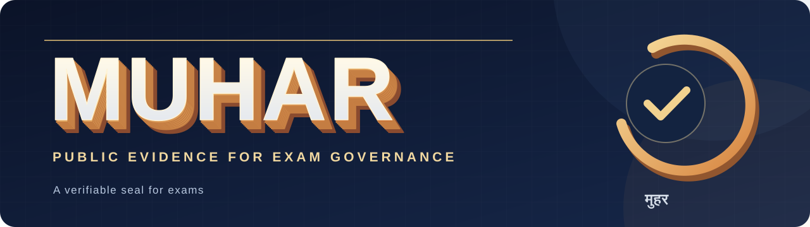

# Muhar (मुहर)

**A verifiable seal for exams.**

An exam asks students to trust a private chain of decisions: which questions were eligible, when the rules were fixed, how the paper was chosen, what reached each centre, and what happened when something went wrong. **Muhar is a proposed open-source evidence protocol for those decisions.** It lets an exam operator keep questions confidential before the test while giving candidates, auditors, and the public specific claims they can check afterward.

The idea grew from Devcon 8 India's [“What Can Ethereum Do for India? The Exam Leak Challenge”](https://cfp.devcon.org/devcon8/talk/QB3PET/). The [October 2026 parliamentary committee recommendations](https://www.pib.gov.in/PressReleseDetailm.aspx?PRID=2321420&lang=1&reg=1) likewise call for large reviewed question banks, papers assembled close to the exam, independent audits, secure grievances, and attention to real centre and candidate constraints. Neither source endorses Muhar.

> **Status:** design proposal. There is no deployable exam software here, no institutional partner, and no claim of affiliation with an exam authority.

## The problem, stated narrowly

For one publicly announced exam session, can independent parties later establish that **one authorised inventory and set of rules were frozen before a future random draw; the released paper followed those rules; and exceptions were recorded in a history that could not be quietly replaced?** Can a candidate challenge the evidence and receive an accountable response?

That is a coordination and governance problem as well as a cryptographic one. Authors, bank curators, exam operators, software vendors, centre staff, auditors, and candidates see different parts of the process. A signature proves that a key signed a statement; it cannot prove that a person spoke truthfully, that a screen displayed the signed bytes, or that the questions were fair.

| Devcon lens | Design response |
| --- | --- |
| **Governance** | The operator owns decisions; a public charter fixes authority, exceptions, challenges, and remedies. |
| **Real world** | Centre devices, late entry, accessible delivery, outages, and human custody are explicit trust boundaries. |
| **Coordination** | Operator, bank auditor, witnesses, and candidates work from one named session and a visible event history. |
| **Decentralisation** | Distribute evidence retention and checking where it helps; keep legal exam operation with an accountable institution. |

## What a verifier could say

| Question after the exam | Evidence Muhar proposes | What still needs human trust or review |
| --- | --- | --- |
| Were eligibility rules and the question inventory fixed before the draw? | An institutionally authenticated, signed manifest; an independently witnessed log checkpoint; and a preselected future beacon round. | The bank auditor must assess whether the eligible items and labels were honest. |
| Was the paper drawn by the published rules? | A deterministic replay using the disclosed ordered inventory, blueprint, algorithm, and [signature-verified beacon](https://docs.drand.love/docs/specification/). | If the reusable inventory cannot be disclosed, this claim becomes **auditor-attested**, not publicly reproduced. |
| Was that paper sent to the centre? | A signed full paper package, exact content and rendered-file hashes, and operator and centre receipts. | A compromised centre can still misdisplay or copy the paper. Receipts are claims about delivery, not proof of pixels. |
| Was there no leak, and was the exam fair? | **Muhar cannot certify either claim.** | Insider access, question quality, translations, accommodations, scoring, investigation, and remedies need separate controls. |

The public verifier should report each check as `VERIFIED`, `FAILED`, or `INCOMPLETE` with its evidence. It must never collapse them into an “exam secure” badge.

## One session, from private bank to public evidence

```text
Reviewed private question bank
         │  salted item commitments + signed blueprint
         ▼
One frozen session manifest ──► witnessed transparency log ──► proposed Ethereum checkpoint
         │
         ▼
Precommitted future beacon round ──► deterministic draw
         │
         ▼
Signed paper package ──► controlled CBT import and centre receipt
         │
         ▼
Post-exam disclosure ──► independent replay, challenge, and accountable response
```

One legally accountable exam operator still decides whether to run, pause, or cancel the exam. Independent institutions audit the bank and witness the record; later phases may separate release keys among custodians. Candidates need no wallet. Question text, answer keys, candidate data, and release secrets stay off-chain. A cancellation after the draw must be signed, explained, linked to any replacement, and reviewed: otherwise the operator could keep redrawing until it likes the result.

## Does this need Ethereum?

That is an experiment, not an article of faith. [Independent witnesses can already cosign a transparency log's checkpoints](https://blog.transparency.dev/can-i-get-a-witness-network/) and detect inconsistent histories. Ethereum may add a neutral, publicly accessible ordering and timestamp for a small checkpoint when institutions do not fully trust one another. It cannot authenticate an exam authority, make missing log data available, or prove an off-chain fact. There is no case for a token, candidate wallet, DAO, or new chain.

The first pilot should compare **a witnessed log alone** with **the same log plus a finalized Ethereum anchor**. Inject a conflicting history and a late manifest; measure whether independent verifiers detect each case, and compare cost, finality delay, availability, and operator burden. If the anchor adds no meaningful protection, keep it out of the required path.

## Hard objections before a real exam

1. **A full-bank insider wins at the public draw.** Once the seed is known, anyone who can read the whole bank can derive the selected paper. Bank compartments, access control, short release windows, and human custody matter more than a chain transaction.
2. **Correct randomness does not mean a fair paper.** Academic review, duplicate detection, language equivalence, psychometric calibration, and multi-form score comparability remain independent gates.
3. **“Independent” parties may depend on the operator.** The charter must name how auditors and witnesses are appointed, funded, rotated, challenged, and replaced, and who must answer a candidate's grievance.
4. **Failing closed can hurt candidates.** A beacon, power, or network outage may force a postponement. Late entry, disability accommodations, rural connectivity, and centre failures need a published policy and a remedy path.
5. **A mock cannot prove national readiness.** A one-centre test with synthetic items can validate protocol behaviour and candidate comprehension. It cannot validate live bank secrecy, collusion resistance, assessment quality, or nationwide operations.

[WAR_ROOM_REPORT.md](WAR_ROOM_REPORT.md) develops the opposing arguments, three architecture choices, evidence gaps, and tests that could falsify the proposal.

## First build

- `muhar-draw`: canonical commitments, a pinned future beacon round, and a deterministic draw over disjoint question strata, with independent test vectors.
- `muhar-log`: an append-only, signed record with inclusion and consistency proofs, independently retained checkpoints, and an experimental Ethereum anchor.
- `muhar verify`: separate results for freeze timing, draw replay, selected content, exact paper match, log consistency, and signed delivery claims.

Start with a **low-stakes, one-centre, single-session digital mock** using synthetic or retired questions. Publish the complete permitted proof bundle after the mock, ask outsiders to verify it, deliberately test tampering and outages, and record whether candidates understand and can challenge the result. Do not use live questions until independent security, privacy, assessment, centre-device, and incident-process reviews are complete.

## Design documents

- [PLAN.md](PLAN.md) — governance, protocol, milestones, and pilot gates.
- [DIGITAL_ARCHITECTURE.md](DIGITAL_ARCHITECTURE.md) — digital delivery, proof objects, and failure decisions.
- [THREAT_MODEL.md](THREAT_MODEL.md) — adversaries, residual risks, and verifier invariants.
- [WAR_ROOM_REPORT.md](WAR_ROOM_REPORT.md) — adversarial review and decision ledger.
