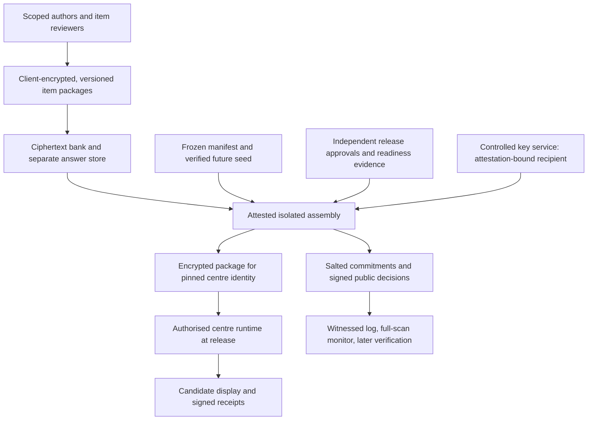

# Muhar sealed-paper architecture

**Design proposal · 9 November 2026 · synthetic prototype only.** This extends the evidence protocol in [DIGITAL_ARCHITECTURE.md](DIGITAL_ARCHITECTURE.md). The first confidentiality experiment must build the complete sealed-paper path, rather than postpone all secrecy controls until after a draw demo. Nothing here is implemented or independently evaluated yet.

## 1. The security promise we can test

The proposed promise is: **before the charter's authorised release boundary, no single authorised human role can preview or export the assembled paper through the designed system; only the approved isolated assembly process can access selected plaintext, and it releases output only after the declared independent approvals.** This is conditional on the selected hardware, software, key-policy, administration, and non-collusion assumptions. A deployment that allows one administrator to bypass those controls cannot advertise this promise.

“Nobody sees any question” is incompatible with human authorship, translation, accessibility review, and assessment quality. Authors and reviewers see assigned items. Candidates must see the final paper during the exam. The goal is to constrain **scope, timing, and concentration of access**, while preserving enough review to produce valid questions. Encryption cannot make people forget a question they authored or remove a copy they already retained.

The release boundary must be explicit. If a CBT vendor must receive readable questions at `T−60m`, confidentiality against that vendor ends then, even when candidates start at `T`. A near-start release reduces this interval but must satisfy measured delivery and device-readiness constraints. There is no universal “sealed until the gates close” guarantee.

## 2. Threat model and the hardest counterexample

Treat a bank administrator, assembly-server administrator, corrupt reviewer, release official, CBT vendor, or centre operator as a possible insider. Consider compromised credentials, modified builds, restore/rollback, logs and crash dumps, and collusion between roles. The first mock tests one malicious role at a time, then named combinations; it must not infer security against every possible coalition.

**A full-bank insider defeats a public draw.** If a person already has the entire eligible bank, the inventory mapping, and draw rules, a public seed reveals the selected paper immediately. Threshold release keys cannot undo that knowledge. A bank previously exported as one readable file fails the stronger confidentiality premise even after re-encryption. The adopting institution must map historical as well as current access and use a fresh, compartmented inventory if it wants to test the stronger claim.

Full-bank access is sufficient, **not necessary**, for that failure. A reviewer or coalition may know every item that happens to be selected, plus enough metadata to recover its order, while knowing only part of the bank. Review cumulative access against possible selected forms, including overlapping assignments and prior exams. Add a partial-bank negative control that reconstructs the full selected form. If a deployment needs a strict bound on one actor's known selected content, encode and independently review that constraint in the blueprint before freeze; the present disjoint-stratum algorithm must not be assumed to enforce an unspecified access constraint. Never redraw after seeing the seed to hide a failed overlap test. Otherwise narrow the claim to preventing additional system-mediated preview/export, with remembered-item exposure stated explicitly.

[Drand's security model](https://docs.drand.love/docs/security-model/) describes threshold assumptions, early knowledge and withholding risks. A verified round authenticates randomness; it does not prove no insider learned it early. Its [timelock encryption](https://docs.drand.love/docs/timelock-encryption/) makes decryption possible once the target beacon is published. Muhar must therefore use a beacon as a selection input or release-time condition, not as the only authorisation for secret delivery.

## 3. Who sees what, and when?

| Stage / role | Permitted visibility | Forbidden concentration or export | Residual exposure |
| --- | --- | --- | --- |
| Author | Their assigned question, assets, and answer | Whole-bank browsing; final-form preview | An author can retain or leak an item they created. |
| Translator / accessibility reviewer | The specific item and variants assigned for review | A master export of every language and all items | Colluding reviewers may aggregate their legitimate views. |
| Academic reviewer | Assigned subsets; signed item approval and review scope | Automatic access to the whole inventory or assembled form | Smaller compartments can reduce cross-item review quality; measure the tradeoff. |
| Bank administrator | Opaque IDs, approved metadata, encrypted objects, workflow status | Plaintext export, unrestricted review impersonation, decrypt authority | Metadata and access-pattern leakage may reveal subject or selection clues. |
| Bank audit function | Review assignments, signed approvals, coverage and conflict reports; authorised item samples | An assumed omniscient auditor holding a readable full-bank copy | An attestation must state the subset and checks actually reviewed. |
| Isolated assembly process | Frozen metadata; selected item plaintext transiently; approved output renderer | General export API, arbitrary query access, debug output, answer keys | Trusted code/hardware may be flawed; the process is a real trust boundary. |
| Release custodians | Session, opaque form commitment, target-device identities, policy and readiness evidence | Question plaintext or authority to change the bank alone | Enough colluding custodians can authorise an improper release if other checks permit it. |
| CBT transport service | Encrypted package and routing envelope where the adapter supports this | Mandatory plaintext central import before the declared release time | A legacy import requiring plaintext changes the secrecy boundary and must be labelled. |
| Centre runtime and candidates after release | Authorised questions and required variants | Unselected bank, answer keys, other sessions' forms | A compromised runtime or corrupt official can copy, transmit, solve, or misdisplay released content. |
| Public verifier after disclosure | Permitted openings, signed decisions, complete log through stated cutoffs | Personal evidence and still-reusable secret content | Cryptographic replay does not certify fairness or absence of cheating. |

If the assessment team requires a human to inspect the complete final form, name that role and the earliest viewing time in the charter. Use controlled review and quarantine where approved, but downgrade the no-human-preview claim. Silently removing academic review to preserve a cryptographic slogan would make the exam worse.

## 4. Three architectures, with actual trust boundaries

| Option | Mechanism | Strongest advantage | What breaks the promise | Decision |
| --- | --- | --- | --- | --- |
| **A. Conventional assembly service with HSM/KMS and approval workflow** | Encrypted items; protected wrapping keys; an application decrypts selected items in ordinary server memory after approvals. | Familiar deployment and simplest operational baseline. | A sufficiently privileged host/application administrator may read memory or change the program; protecting keys at rest does not protect returned plaintext. | Build a synthetic reference runner to measure workflow and expose this limitation. Do not claim administrator-resistant sealed assembly. |
| **B. Attested isolated assembly with controlled key release** | Decrypt only inside a measured trusted execution environment; verify manifest and seed there; check signed release permits; encrypt output directly for approved centre identities. | Makes a concrete attempt to keep selected plaintext outside the parent host and normal administrative tools. | Trusted hardware/firmware, attestation verification, enclave code, input handling, policy administrators, side channels, and release-recipient compromise remain in scope. | **Selected synthetic confidentiality prototype**, with an explicit trust inventory and adversarial acceptance gates. No live-secret claim until independently reviewed. |
| **C. Distributed confidential computation / MPC** | Separate organisations hold shares and jointly compute the necessary confidential operation under a defined corruption threshold. | Can reduce reliance on one plaintext-processing machine or one hardware vendor for selected computations. | Collusion beyond the threshold, output leakage, implementation/protocol errors, latency, and availability. Whole multimedia assembly and rendering are substantial engineering work. | Research only. Benchmark a bounded subproblem before considering it for the critical path. |

An HSM is a key-protection component; it does not make every application using it confidential. A trusted execution environment (TEE) is isolated execution under a hardware/vendor model; attestation identifies measured code, not its correctness. [AWS's attested KMS API](https://docs.aws.amazon.com/kms/latest/developerguide/attested-calls.html) illustrates a usable mechanism: decryption results are encrypted to the public key in a valid recipient attestation. Its [policy documentation](https://docs.aws.amazon.com/kms/latest/developerguide/conditions-attestation.html) also shows why broad default key permissions are dangerous. This is a reference capability, not a vendor selection or a claim that AWS alone implements Muhar's controls.

[NIST's threshold cryptography project](https://csrc.nist.gov/Projects/threshold-cryptography) distinguishes computation over distributed key shares from reconstructing a key at one machine. **Two-of-three signed approvals are an application authorisation quorum, not cryptographic threshold decryption.** Shamir-sharing a key and later rebuilding it in an ordinary process exposes it there. An MPC or threshold-decryption upgrade needs an independently reviewed protocol, specified corruption threshold, malicious-party handling, and a measured implementation; naming the technique is insufficient.

## 5. Proposed first sealed pipeline

### A. Compartment and review before sealing

Authors work on assigned items. Review assignments expose only required items and variants. Avoid a public-issue tracker, email attachment, general analytics pipeline, or external AI service as a secret-question channel. Track which humans and endpoints have seen each item; this is a sensitivity record, not proof that they did not copy it.

Separate authoring, review assignment, release approval, and key-policy administration. Cross-bank duplicate/coverage checks may run in a separate approved isolated process; its outputs and access need review too. A human auditor validates the review process and selected samples, and states the limits of that assurance. Do not pretend that a signature on an inventory root means every item was independently inspected by one person without giving that person access.

Seal each approved item version after review. Store question/asset packages and answer-key packages under separate keys and access policies. Later edits create new versions and require review; frozen versions are never overwritten. Rotating a key protects future storage access but cannot revoke previous human knowledge or exports.

### B. Encrypt objects and bind their context

Use a maintained library for authenticated encryption with associated data (AEAD), with independent data keys and correct nonce management. Bind item ID, bank/version, content type, and schema version in authenticated context; bind the inventory-to-session mapping in the signed manifest. Sign authorship/review metadata separately. [NIST SP 800-38D](https://csrc.nist.gov/pubs/sp/800/38/d/final) defines an established AEAD construction; algorithm selection and limits must be pinned in the reviewed implementation specification.

The storage service receives ciphertext and wrapped data keys. No public question/answer hash should be guessable: preserve the existing salted commitment design. Restrict selected-ID lists and access telemetry where they could help insiders map questions to a form. Encryption of data at rest does not protect an author workstation that currently displays plaintext.

### C. Bootstrap a known assembly environment

Before loading secret material, independently verify the signed build, reproducible-build evidence, measurement allowlist, software version, and deployment policy. Reject development/debug images. Establish an attested recipient channel and validate the identity of its ephemeral key; include a fresh challenge and expiry in the release-controller protocol so an old attestation is not silently accepted as a fresh run. The exact platform verification and freshness mechanism is an implementation gate, not assumed present.

Bind the approved measurement, protocol version, frozen manifest hash, release policy, device keyset, and session epoch. A cold replacement process must re-attest and prove it is using the current session state. External witnessed state and independent custodians must reject rollback to an older manifest, permit, recipient key, or epoch; enclave memory alone is not durable anti-rollback protection.

### D. Select and assemble without a human preview

The isolated process verifies the institution's signed manifest, the required witnessed evidence and monitor status, the exact beacon identity/round, and the draw algorithm. It selects IDs deterministically and requests only their question-package data keys. It verifies the selected openings, all authorised language/accessibility variants, ordering, assets, and output digest. Answer-key keys are not available to this assembly role.

Selected plaintext exists transiently inside the approved process. Its only permitted outputs before release are bounded non-sensitive status and salted commitments; never a preview endpoint, selected text, diagnostic dump, or arbitrary user-supplied output destination. Pre-review item rendering and exercise the final renderer with synthetic media, fonts, formulas, and accessibility assets. Arbitrary plugins or remote resource fetching would enlarge the trusted code and exfiltration surface.

### E. Authorise the exact release

For the mock, propose **two-of-three independent signed release approvals** from the operator, external exam controller, and release custodian; their actual identities and independence must be agreed before use. A permit binds session ID, manifest hash, form commitment, recipient device-key identity, session epoch, allowed release interval, expiry, unique nonce, and policy version. The enclave verifies the permit and recipient allowlist; the centre cannot substitute a new public key in transit.

Do not trust the parent host's clock for the release boundary. Specify and test an authenticated time condition, such as a separately precommitted release beacon round plus fresh independent approvals, or another reviewed time source. A public beacon condition alone does not authorise output. Seed time, assembly time, and authorised release time are different fields.

At release, encrypt the signed package directly to the approved centre runtime identity and send it through the CBT transport adapter. A device identity is not proof that its operating system or people are honest. If a legacy CBT main server must decrypt and repack the paper, include it as a plaintext recipient and revise the promise; the adapter cannot erase that boundary. Prepositioned encrypted forms require a separately reviewed release-key design and are deferred in the first prototype.

### F. Contain failure and retain evidence

A missing approval, wrong attestation, missing monitor update, invalid seed, outdated epoch, wrong recipient, or expired permit pauses the synthetic session and generates a signed incident. Freeze primary and any backup recipient keys before the seed. In v0, a lost device may be replaced only by an already frozen backup under an exact signed permit and recorded incident; adding a new recipient key requires cancellation and a linked new session. A generic signed policy action cannot amend the frozen keyset. A retry may resend the same authorised ciphertext/package but cannot trigger a new draw. Cancellation uses the existing linked-session rules.

There is no emergency “download the paper” path. A recovery that requires human plaintext access changes the security profile and must cancel/restart under a disclosed exception rather than keep the sealed claim. Availability loss can still harm candidates; the operator must precommit communication, retest, and remedy procedures.

## 6. The bypasses that decide whether this is honest

| Bypass to inspect | Required evidence before any live-secret pilot |
| --- | --- |
| One administrator changes the KMS policy or measurement allowlist and decrypts everything | Document every policy-changing principal, root/break-glass path, and approval enforcement. If one trusted superadministrator can bypass the design, name that trust assumption; do not claim protection against that actor. Independent monitoring detects some changes but does not prevent exfiltration after them. |
| A correctly attested but malicious build outputs plaintext | Independent source/build review, pinned measurement, signed change approval, bounded output schema, and adversarial egress tests. Attestation cannot establish that code is benevolent. |
| Logs, metrics, error strings, screenshots, crash dumps, swap, snapshots, backups, or support bundles retain questions | Enumerate each sink; prohibit plaintext there; test failure paths and backup restoration with synthetic markers. Deletion claims must cover replicas and retained keys. |
| Restore creates a new valid-looking session with an old permit | Bind all state and permits to epoch and manifest; test restored snapshots against independently retained current state. Replays must not cause a second release or redraw. |
| Key approval UI protects ordinary users but a service credential calls decrypt directly | Exercise every permitted API/principal path; prove key release is constrained to the attested recipient and approved context. A UI quorum alone is insufficient. |
| Full-bank audit or migration export creates an unseen master copy | Audit historical access and migration paths. A previously exported bank cannot satisfy the no-full-bank-human premise by changing software alone. |
| Centre officials assist selected candidates after a valid release | Separate centre controls, independent supervision, restricted remote access, evidence preservation, and candidate appeal. A perfect sealed package does not prevent this fraud. |

## 7. Build gates and discriminating tests

| Gate | Deliverable | Required result |
| --- | --- | --- |
| 0. Access and visibility model | Synthetic inventory, role assignments, signed release-policy draft, declared clock/TEE/admin assumptions | A reviewer can trace every plaintext/key holder and every override, including authoring and recovery. |
| 1. Sealed workflow reference | Client encryption, scoped review, versioned objects, deterministic assembly, exact release permits, centre adapter, and public proof using synthetic items | Mutation, wrong version/session/recipient, one approval, replay, and early release fail. Ordinary-host administrator access remains explicitly demonstrable in baseline A. |
| 2. Attested assembly experiment | The same pipeline in selected TEE hardware with attestation-bound key delivery and restricted output | Parent-host credentials cannot decrypt directly under tested policy; wrong/debug measurement and stale attestation fail; test encrypted transport, logs, crash paths, and restore. Passing tests supports only the exercised threat model. |
| 3. Centre collusion and outage mock | Honest and deliberately untrusted centre simulations, both handoff schedules, lost custodian/device, power/link failures | Valid cryptographic proofs coexist with some centre cheating in the negative-control scenario; the report must state that residual failure and exercise an accountable remedy. |
| 4. Independent review before live secrets | Cryptography, deployment administration, assessment quality, accessibility, bank history, endpoint, privacy, and incident review | No unresolved claim-changing bypass; operator accepts the remaining assumptions and candidate consequences. |

The decisive confidentiality test is to give the mock adversary one **declared** privileged role and ask it to recover a synthetic selected question before authorised release through any allowed administration or recovery path. A single success falsifies the claimed isolation for that role. The decisive governance test is a valid package delivered to a colluding centre: if Muhar calls that entire exam secure, the reporting design is wrong.

Run distinct knowledge tests with (a) the complete bank and (b) a proper subset containing all actually selected items and enough selection metadata. Both can defeat whole-form secrecy without invoking a decrypt API. Distinguish an unauthorized new plaintext export from information already legitimately learned during authorship; both matter to the promised secrecy scope, but they require different mitigations.

Measure earliest plaintext exposure by role, assembly and delivery latency, required intervention count, fail-closed delays, recovery behaviour, and exact leak paths in controlled tests. An absence of observed leakage in one mock is not proof of secrecy. Ethereum remains an optional evidence anchor; it neither holds the question secrets nor supplies the confidentiality boundary above.
